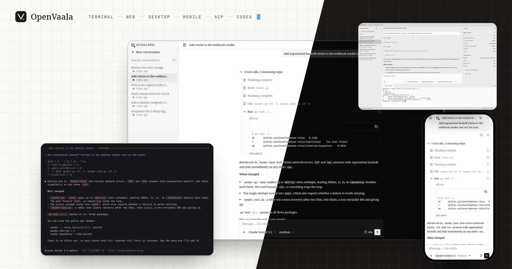

<div align="center">


# OpenVaala

A self-hostable, general-purpose agent system: one runtime for the agent loop, tools on the machines you choose, and the same live conversations in every client.

English | [简体中文](README.zh-CN.md) · [Documentation](https://vaalacat.github.io/openvaala/) · [Quickstart](https://vaalacat.github.io/openvaala/getting-started/quickstart)

</div>



## Why OpenVaala

OpenVaala keeps the agent loop, tool execution and the interfaces apart — a centralized agent loop with distributed tool execution.

- **One runtime, many machines.** The runtime server manages each task's progress and context, while file edits and commands run on the executors you pick: this machine, a built-in sandbox, and any number of SSH hosts such as a build box, a GPU machine or a staging server. One conversation can use several of them, choosing the machine for each tool call. Executors are a pluggable layer; workers on other machines and hosted sandboxes are planned.
- **Many clients, one live conversation.** The terminal UI, the web UI (on your phone too), the desktop app, editors over ACP such as Zed, and Codex clients — the Codex terminal UI and desktop app — attach to the same runtime and the same conversations. Start in the terminal, check from your phone, finish in your editor; streaming output, queued messages and tool results are shared, not just the chat log.
- **Works with what you have.** Models over OpenAI Chat Completions, OpenAI Responses or Claude Messages; clients over ACP and the Codex app-server protocol; tools over MCP. Swap one piece without rebuilding the rest.
- **Conversations you can take with you.** Each conversation is its own directory of JSONL records, indexed by a SQLite database that can be rebuilt at any time. Read it, back it up or move it to another machine. Storage is pluggable by design.

## Install

OpenVaala runs on Linux and macOS (amd64 and arm64).

- **GitHub Releases** — download the `openvaala` binary for your platform, which includes the web UI, or a desktop package for macOS or Linux, from [Releases](https://github.com/VaalaCat/openvaala/releases).
- **go install** — the command-line tool with the web UI from the latest release:

  ```bash
  go install github.com/VaalaCat/openvaala/cmd/openvaala@latest
  ```

- **From source** — `script/build.sh` builds the CLI with the web UI (Go 1.27.3+, Node.js 24+, pnpm); `script/build-desktop.sh` builds the desktop app.

See [Install](https://vaalacat.github.io/openvaala/getting-started/install) for details.

## Quickstart

1. Start the terminal UI in a project directory. The first run walks you through adding a model provider:

   ```bash
   cd ~/code/my-project
   openvaala
   ```

2. Type a request, such as *"Explain how this project is built and run its tests"*, and watch the agent work. Press Enter to steer it while it runs, Tab to queue a follow-up, Esc twice to interrupt.

3. Open the same conversation in your browser:

   ```bash
   openvaala web
   ```

OpenVaala runs tools without asking for confirmation; start somewhere you are comfortable letting an agent work, and use [hooks](https://vaalacat.github.io/openvaala/configuration/extensions#hooks) to add checks.

## Documentation

- [Getting started](https://vaalacat.github.io/openvaala/getting-started/quickstart) — install, add a model, first conversation.
- [Guides](https://vaalacat.github.io/openvaala/guides/conversations) — conversations, the terminal, web and desktop interfaces, editors and Codex.
- [Configuration](https://vaalacat.github.io/openvaala/configuration/overview) — models, agents, executors, tools, skills, MCP servers, hooks and plugins.
- [Reference](https://vaalacat.github.io/openvaala/reference/cli) — every command and flag, and the architecture.

The documentation also ships inside OpenVaala as a built-in skill, so you can ask an agent how to configure it.

## Status

OpenVaala is under active development and has not reached 1.0. Configuration, the runtime protocol and public APIs may change between releases.

## License

OpenVaala is released under the [MIT License](LICENSE). Third-party notices are in [`www/THIRD_PARTY_NOTICES.md`](www/THIRD_PARTY_NOTICES.md) and [`resources/licenses/`](resources/licenses/).
