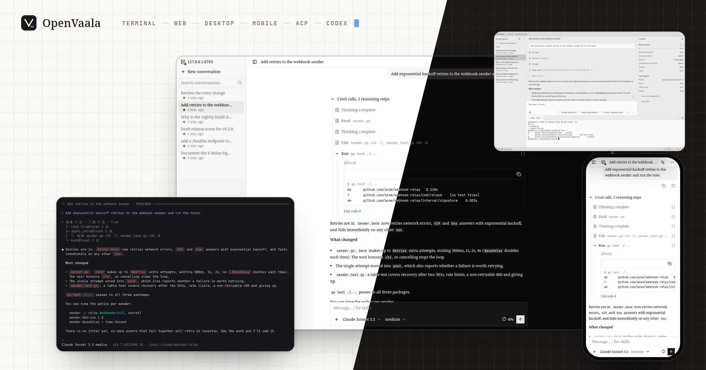

<div align="center">


# OpenVaala

统一运行，跨机执行，多端共享。一个可自托管的通用 Agent 系统：Agent 主循环在一处运行，工具在你选的机器上执行，每个客户端看到的都是同一份实时进展的对话。

[English](README.md) | 简体中文 · [文档](https://vaalacat.github.io/openvaala/zh/) · [快速开始](https://vaalacat.github.io/openvaala/zh/getting-started/quickstart)

</div>



## 为什么选 OpenVaala

OpenVaala 把 Agent 主循环、工具执行和界面分开：Agent 主循环集中运行，工具分布执行。

- **统一运行，跨机执行。** 每个任务的进展和上下文由 Runtime 服务统一管理，文件改动和命令在你选的 Executor 上运行：这台机器、内置沙箱，以及任意多台 SSH 主机，比如构建机、GPU 机器或预发布服务器。一个对话可以同时用其中好几台，每次调用工具时选一台。Executor 是可替换的一层，对其他机器上的 worker 和托管沙箱的支持在计划中。
- **多种入口，同一份进展。** 终端界面、Web 界面（手机上也能用）、桌面端、Zed 这类通过 ACP 接入的编辑器，以及 Codex 客户端（Codex 终端界面和桌面版），都连着同一个 Runtime、同一批对话。在终端发起，用手机看进度，回到编辑器做完；共享的不只是聊天记录，还有正在生成的输出、排队的消息和工具结果。
- **接入不同生态，不绑定单一入口。** 模型侧用 OpenAI Chat Completions、OpenAI Responses 或 Claude Messages；客户端侧用 ACP 和 Codex app-server 协议；工具侧用 MCP。换掉其中一项，不用重搭其他部分。
- **对话独立保存，数据可以带走。** 每个对话是一个独立目录，记录存成 JSONL，SQLite 数据库只做索引，随时可以重建。能直接查看、单独备份，也能搬到另一台机器。存储层在设计上就是可替换的。

## 安装

OpenVaala 支持 Linux 和 macOS（amd64 和 arm64）。

- **GitHub Releases**：从 [Releases](https://github.com/VaalaCat/openvaala/releases) 下载你平台的 `openvaala` 二进制（内置 Web 界面），或者 macOS、Linux 的桌面端安装包。
- **go install**：安装最新发布版的命令行工具，内置 Web 界面：

  ```bash
  go install github.com/VaalaCat/openvaala/cmd/openvaala@latest
  ```

- **从源码构建**：`script/build.sh` 构建带 Web 界面的 CLI（需要 Go 1.27.3+、Node.js 24+、pnpm）；`script/build-desktop.sh` 构建桌面端。

详见[安装](https://vaalacat.github.io/openvaala/zh/getting-started/install)。

## 快速开始

1. 在项目目录里启动终端界面。第一次运行会带你添加模型 Provider：

   ```bash
   cd ~/code/my-project
   openvaala
   ```

2. 输入一个请求，比如*「讲讲这个项目怎么构建，再跑一下测试」*，看 Agent 工作。它运行时按 Enter 补充消息，按 Tab 排队下一个请求，连按两次 Esc 中断。

3. 在浏览器里打开同一个对话：

   ```bash
   openvaala web
   ```

OpenVaala 运行工具前不会征求确认。请从一个你放心让 Agent 动手的地方开始，需要检查时用 [hook](https://vaalacat.github.io/openvaala/zh/configuration/extensions#hook)。

## 文档

- [入门](https://vaalacat.github.io/openvaala/zh/getting-started/quickstart)：安装、添加模型、第一个对话。
- [使用指南](https://vaalacat.github.io/openvaala/zh/guides/conversations)：对话，终端、Web 和桌面端界面，编辑器和 Codex。
- [配置](https://vaalacat.github.io/openvaala/zh/configuration/overview)：模型、Agent、Executor、工具、skill、MCP server、hook 和插件。
- [参考](https://vaalacat.github.io/openvaala/zh/reference/cli)：所有命令和参数，以及架构。

这份文档也作为内置 skill 打包在 OpenVaala 里，可以直接问 Agent 怎么配置。

## 项目状态

OpenVaala 还在活跃开发中，没有到 1.0。配置、Runtime 协议和公开 API 在不同版本之间可能会变。

## 许可

OpenVaala 以 [MIT 许可证](LICENSE)发布。第三方声明见 [`www/THIRD_PARTY_NOTICES.md`](www/THIRD_PARTY_NOTICES.md) 和 [`resources/licenses/`](resources/licenses/)。
