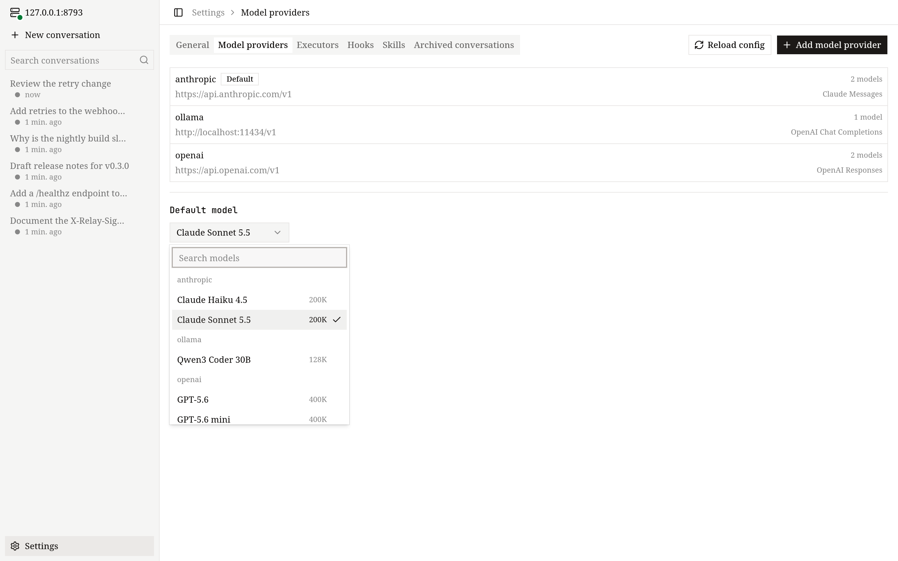

# Models

This page explains how to connect OpenVaala to model providers and describe the models you want to use.

A *provider* is one file in `~/.config/openvaala/models/` that holds an address, an API key and a list of models. Agents refer to a model as `provider_id/model_id`, for example `openai/gpt-5`.

## Add a provider without editing files

The quickest way is the provider setup in any client:

- **Terminal UI:** the first run walks you through it when no model is configured; later, open `/provider`.
- **Web UI and desktop app:** **Settings → Model providers**.

You pick a service from a catalog based on [models.dev](https://models.dev), which fills in the protocol, base URL and known model limits; then you enter your API key and choose models. The client can also fetch the model list from the provider itself. The result is an ordinary provider file, which you can edit afterwards.



## A complete provider file

```yaml
# ~/.config/openvaala/models/openai.yaml
id: openai                         # must match the file name
protocol: openai_responses         # default protocol for models in this file
base_url: https://api.openai.com/v1
api_key: sk-...
models:
  gpt-5:                           # model id inside OpenVaala; upstream_model defaults to it
    display_name: GPT-5
    context_window: 400000
    max_output_tokens: 128000
    reasoning_efforts: [minimal, low, medium, high]
    default_reasoning_effort: medium
    capabilities:
      input: [text, image]
  mini:
    upstream_model: gpt-5-mini     # the name sent to the provider
```

A provider that speaks several protocols can mix them. Here one gateway serves both OpenAI-style and Claude models, and the Claude endpoint lives on a different host:

```yaml
# ~/.config/openvaala/models/gateway.yaml
id: gateway
protocol: openai_chat
base_url: https://gateway.example.com/v1
api_key: ...
endpoints:
  claude: https://claude.example.com/anthropic/v1/messages
models:
  qwen3-coder: {}
  claude-sonnet:
    upstream_model: claude-sonnet-4-5
    protocol: claude
    capabilities:
      input: [text, image]
```

## Protocols

OpenVaala speaks three wire protocols to model providers, alongside the client and tool protocols it supports:

```text
 models             clients          tools
 openai_responses   terminal, web,   built-in tools
 openai_chat        desktop          MCP servers
 claude             ACP editors      (stdio, http, sse)
                    Codex
     │                  │                │
     └──────────────────┼────────────────┘
                        ▼
                 runtime server
```

Use these exact names in `protocol` and as keys of `endpoints`:

| Name | API | Path appended to `base_url` |
| --- | --- | --- |
| `openai_responses` (default) | OpenAI Responses | `/responses` |
| `openai_chat` | OpenAI Chat Completions | `/chat/completions` |
| `claude` | Anthropic Claude Messages | `/messages` |

`openai-responses` is also accepted in `protocol` and is normalized to `openai_responses`; `endpoints` keys must use the exact names above.

## Provider fields

- `id` — required. Letters, digits, `-`, `_` and `.`, matching the file name without `.yaml`.
- `protocol` — the protocol for models that do not set their own. Defaults to `openai_responses`.
- `base_url` — required. An `http` or `https` URL including the version prefix, such as `https://api.openai.com/v1`. It may not contain a user name, a query string or a `#` fragment. OpenVaala appends the protocol path shown above.
- `endpoints` — optional full request URLs per protocol, used instead of `base_url` for that protocol. They may point to another host. Each value must be an `http(s)` URL with a real path (not just a host or `/`), and the same restrictions as `base_url` apply.
- `api_key` — the key sent to the provider, stored in plain text. Leave it empty for local servers that need none.
- `headers` — optional request headers sent only to this provider, with its model requests and its model list. A name that also appears in `http.headers` in `config.yaml` replaces that entry, and `""` stops sending it. Values can use the `${OPENVAALA_...}` variables described under [`http`](overview.md#http).
- `models` — required, at least one entry. Keys are model ids (letters, digits, `-`, `_`, `.`). A model with no settings can be written as `name: {}`.

For example, an extra header for one gateway, and no `Session-Id` for it:

```yaml
# ~/.config/openvaala/models/openrouter.yaml (excerpt)
headers:
  X-Title: MyTool
  Session-Id: ""
```

## Model fields

Every field is optional. Fields you leave out come from `models.defaults` in `config.yaml`, except where noted.

- `upstream_model` — the model name sent to the provider. Defaults to the model id.
- `protocol` — overrides the provider's protocol for this model only.
- `display_name` — the name shown in model pickers. Defaults to the model id.
- `context_window` — the model's context window in tokens. Automatic compaction is based on it, so set it to the real value.
- `max_output_tokens` — sent with every request as the output limit. If your model's limit is lower than the default 32000, set it here.
- `thinking` — whether to ask the model to think or reason before answering. `true` by default.
- `reasoning_efforts` — the reasoning effort levels you can choose from, sent as-is to the provider, for example `[low, medium, high]`. Write `[]` to say the model has no effort setting; leave the field out to inherit the default.
- `default_reasoning_effort` — the effort used when you have not picked one. Must be one of `reasoning_efforts`. If omitted, OpenVaala uses `models.defaults.default_reasoning_effort` when it is in the list, otherwise the first entry.
- `merge_message_roles` — roles whose consecutive messages are merged into one before sending, for providers that reject two messages in a row from the same role. Allowed values are `system`, `developer`, `user` and `assistant`. `[]` turns merging off.
- `reasoning_context` — `all_turns` or `current_turn`. Only valid with the `openai_responses` protocol, and never inherited from `models.defaults`. It is sent as `reasoning.context` and asks the provider how much earlier reasoning the model sees: `all_turns` keeps reasoning from earlier turns, which costs more input tokens; `current_turn` keeps only the current turn's reasoning. When omitted, nothing is sent and the provider decides. Set it only if your provider supports the parameter.
- `capabilities.input` — the kinds of input the model accepts: any of `text`, `image`, `audio`, `video`, `pdf`. An empty list means `[text]`. Without `image`, images in a conversation (including those returned by `read_file`) are replaced by a short placeholder text before sending.

## Inherited defaults

`models.defaults` in `config.yaml` supplies the value for any model field left out. The built-in defaults are:

```yaml
models:
  defaults:
    context_window: 256000
    max_output_tokens: 32000
    thinking: true
    reasoning_efforts: []
    default_reasoning_effort: ""
    merge_message_roles: []
    capabilities:
      input: []        # means [text]
```

Override only what applies to most of your models. For example, if almost all of them accept images:

```yaml
models:
  defaults:
    capabilities:
      input: [text, image]
```

For `reasoning_efforts`, `merge_message_roles` and `capabilities.input`, leaving the field out of a model inherits the default, while writing `[]` sets it to empty for that model.

## Choosing a model

- An agent names its model with `model: {provider: openai, model: gpt-5}`; see [Agents](agents.md).
- Agents without a model use `models.default_model`, or the first model sorted by provider id and model id.
- In a conversation you can switch model and reasoning effort at any time: `/model` in the terminal UI, the model picker in the web UI and desktop app, or the model option in your editor or Codex. The change applies from the next turn.

After editing provider files, run `openvaala config check` and then `openvaala serve reload`; see [Apply changes](overview.md#apply-changes).
