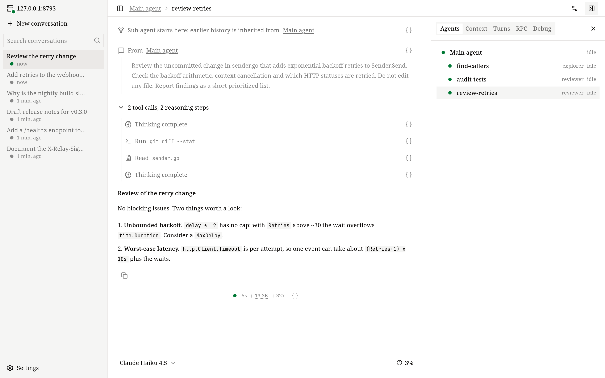

# Conversations

This page explains how conversations behave: subagents, sending input while the agent works, forking and rewinding, how context is managed, and how conversations are stored and moved.

A conversation lives in the runtime server, not in the client you started it from. You can start it in the terminal, watch it in the browser and continue it in your editor; every client sees the same messages, the same running turn and the same tool output as it happens.

## Turns

Each message you send starts a *turn*: the agent calls the model, runs the tools it asks for, feeds the results back, and repeats until it has an answer. A turn ends as completed, failed or interrupted. Conversations run one turn at a time; what you send in the meantime is handled as described below.

Model calls that fail with a temporary error, such as a dropped stream, are retried up to 10 times, waiting from 1 up to 30 seconds between attempts, before the turn fails.

## Queued input and steering

You do not have to wait for a turn to finish. A message you send while the agent is working is handled in one of three ways:

- **Steer** — the message joins the running turn. The agent reads it before its next model call, so you can correct course without starting over. It does not interrupt a model call or tool that is already running. If the turn ends before reading it, the message becomes the next turn.
- **Queue** — the message waits and starts the next turn.
- **Jump the queue** — the running turn is interrupted and this message is handled next.

Messages that are waiting can still be changed: take one back to edit it, withdraw it, hand a queued message to the running turn, or make it jump the queue. Your messages are always handled before messages from subagents. Waiting messages are kept in memory only, so they are lost if the runtime server stops.

| Client | Steer | Queue | Interrupt |
| --- | --- | --- | --- |
| Terminal UI | Enter | Tab | Esc Esc |
| Web UI | Enter | Queue button | Stop button |
| Desktop (native) | Enter | Ctrl/Cmd+Enter | Esc on an empty composer |
| Editors (ACP) | — | — | Cancel |

### Interrupting

When you interrupt, whatever the agent had already produced is kept: partial text stays in the conversation, and unfinished reasoning and tool calls are marked as interrupted. On the next turn the model is told the previous one was interrupted. After you interrupt the root agent, messages from subagents wait until you send something.

## Subagents

An agent can hand parts of a task to *subagents* with the `spawn_agent` tool, for example to explore three parts of a codebase in parallel or to have a reviewer check a change. Each subagent:

- runs with its own context, starting from the task message and, if asked, some of the parent's finished history;
- can be any configured [agent](../configuration/agents.md) — the model picks one by its `description` — and uses the parent's model or its own;
- shares the conversation's executors and working directories;
- reports back to its parent automatically every time it finishes a turn;
- can start subagents of its own.

The parent can message, wait for, interrupt and inspect its subagents with the [collaboration tools](../configuration/tools.md#collaboration-tools). You can follow them in `/agents` in the terminal UI and the **Agents** tab in the web UI; in Codex each subagent is its own thread.



## Fork, rewind, archive and delete

- **Fork** copies a conversation into a new one, so you can try a different direction and keep the original. Only the root agent's history is copied — not subagents, queued messages or the archived state. The terminal UI's `/fork` copies everything up to the latest turn.
- **Rewind** is a fork that stops just before one of your earlier messages and puts that message back in the composer for you to edit and resend. Use `/rewind` (or Esc twice on an empty composer) in the terminal UI, or **Restart from here** in the web UI. The original conversation stays as it was.

<!-- scene: conversation-fork | Fork copies the history; rewind copies it up to one of your messages -->
```text
fork
  original  ●──●──●──●          unchanged
  new       ●──●──●──● ──▶      continue here

rewind to your message ③
  original  ●──●──③──●──●       unchanged
  new       ●──●  ③ back in the composer,
                  edit and resend
```

- **Archive** hides a conversation from the main list without changing it; unarchive brings it back. Archiving does not stop a running turn.
- **Delete** removes the conversation and its directory for good. It is refused while a turn is running.
- **Rename** sets the title. A new conversation is titled automatically from the first line of your first message (up to 40 characters), until you rename it.

A new conversation is saved when you send its first message; one you open and leave empty is not kept.

## Context and compaction

Each model has a limited context window. OpenVaala tracks how much of it a conversation uses and summarizes older history before it overflows.

**Usage.** The figure you see — the context meter in the web UI, `/context` in the terminal UI, the usage report in editors — starts from the token count the provider reported for the last request and adds an estimate for everything added since. Without a recent report it is a full estimate; the web UI tells you which of the two you are looking at.

**Automatic compaction.** Before each model call, if the next request would reach the threshold, the agent first compacts. The threshold is 80% of the model's `context_window`, or `context_window − max_output_tokens` if that is lower, so there is always room for a full answer. This is why `context_window` and `max_output_tokens` in your [model configuration](../configuration/models.md#model-fields) should match the real model.

**What compaction does.** One call to the compact model writes a cumulative summary of the older history, including any earlier summary. From then on the model sees the summary followed by the most recent part of the conversation — at least 20% of the window, in whole steps.

<!-- scene: context-compaction | Older history folds into a summary when the context reaches the threshold -->
```text
window     ├──────────────────────────────────┤
threshold  ├────────────────────────────┤
           min(80% of window,
               window − max_output_tokens)

before  │sys│ 1 │ 2 │ 3 │ 4 │ 5 │ 6 │ 7 │  reaches it
after   │sys│ summary of 1–5 │ 6 │ 7 │      recent part kept

items 1–7 all stay on disk and in your clients
```
The full history stays on disk and visible in your clients; only what is sent to the model shrinks. `AGENTS.md` instructions are added again afterwards. If compaction fails, the turn fails.

**Manual compaction.** `/compact` in the terminal UI, **Compact context** in the web UI, or compact in Codex summarizes the root agent's history right away. It only works when nothing is running or waiting.

**The compact model.** An agent's [`compact_model`](../configuration/agents.md#fields) writes the summaries; by default it is the agent's own model. It needs a context window at least as large as the main model's.

**Reasoning context.** For `openai_responses` models, [`reasoning_context`](../configuration/models.md#model-fields) asks the provider whether earlier turns' reasoning stays in context (`all_turns`) or only the current turn's (`current_turn`). OpenVaala reads which mode the provider actually applied and counts usage accordingly.

## Where conversations are stored

Conversations are stored on the machine that runs the runtime server, under `~/.local/share/openvaala/`:

```text
~/.local/share/openvaala/
├── metadata.db                 index of conversations, sessions and turns (SQLite)
├── runtime.lock                held by the running OpenVaala process
└── conversations/
    └── <conversation-id>/
        ├── metadata.jsonl      the conversation, its sessions and turns, as an append-only log
        └── <session-id>.jsonl  every item of one agent's history: messages, tool calls, images, summaries
```

Each conversation is a self-contained directory of JSON Lines files. Every change is appended and flushed to disk before the index is updated. `metadata.db` only speeds up listing and searching, and can always be rebuilt from the directories:

```bash
openvaala serve stop
openvaala reindex
```

`reindex` replays every `metadata.jsonl`, reports conversations it has to skip, and finishes deletions that were interrupted. It needs the data directory to itself, so stop the runtime server first.

To back up a conversation, copy its directory while the runtime server is stopped.

## Move conversations to another machine

1. On the old machine, run `openvaala serve stop`, then copy `~/.local/share/openvaala/conversations/<conversation-id>/`.
2. On the new machine, put it in the same place, replacing any directory with the same id.
3. Run `openvaala serve stop` if a runtime server is running there, then `openvaala reindex`.
4. Open the conversation from `/resume` in the terminal UI or the web UI's sidebar.

Things to check after a move:

- The conversation remembers its working directory as an absolute path. If that directory does not exist on the new machine, the conversation cannot open; recreate the directory or keep the same layout.
- The agents it used must exist in the new machine's configuration. If a model is missing, choose another one before sending.
- A conversation forked after a compaction reads part of its older history from the conversation it was forked from. Move the two together.
