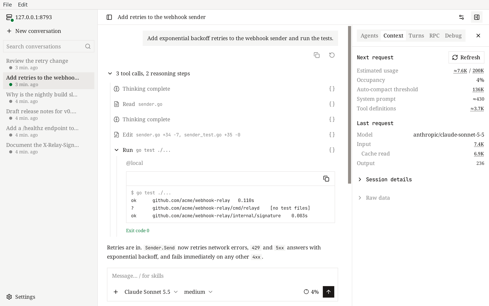
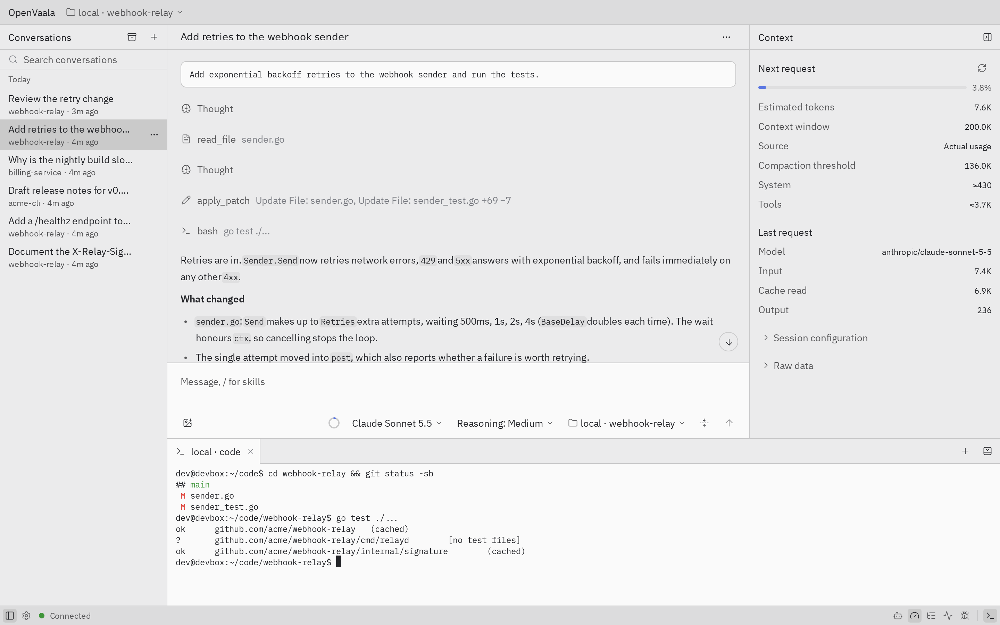

# Desktop

This page covers the OpenVaala desktop app for macOS and Linux: its two interfaces, how it relates to the runtime server, and platform notes.

The desktop app is a single program with two interfaces and the complete command-line tool inside:

- **WebView** (default) — the [web UI](web.md) in a native window.
- **Native** — an interface drawn by OpenVaala itself, with a few extras such as a built-in terminal.



## Open it

Launch **OpenVaala** from your applications menu, or from a terminal:

```bash
openvaala                 # WebView window
openvaala app --native    # native interface
```

Here `openvaala` is the desktop app's own executable (see [Use the CLI from the desktop app](#use-the-cli-from-the-desktop-app)). Each interface runs at most one window; launching the same one again brings the existing window to the front. You can have a WebView window and a native window open at the same time.

A binary installed with [`go install`](../getting-started/install.md#with-go-install) is named `openvaala-desktop`, so it does not replace a command-line `openvaala`. With `$(go env GOPATH)/bin` on your `PATH`:

```bash
openvaala-desktop                 # WebView window
openvaala-desktop app --native    # native interface
```

If no model provider is configured yet, add one in **Settings → Model providers**. The native interface offers an **Add a model provider** button on its empty screen.

## How it relates to the runtime server

Both interfaces use the local runtime server, starting it if needed, so they share all conversations with the terminal UI, the web UI in your browser, your editor and Codex:

<!-- scene: shared-progress | Every client streams the same conversation -->
```text
            runtime server
       ┌─ one conversation ─┐
       │  messages, tools,  │
       │  queue, subagents  │
       └──┬───────┬──────┬──┘
          ▼       ▼      ▼
      terminal  browser  desktop
      (each shows the same turn
       as it streams)
```

A runtime server started by the desktop app keeps running after you close the window, until you run `openvaala serve stop`.

Closing a window does not stop anything you have sent: running turns continue and may keep using your model provider's quota. Terminals opened in the native interface's terminal panel keep running too, and come back in the terminal panel the next time you start the app.

The desktop app always connects to the runtime server on this machine. To work against a server elsewhere, use the [terminal UI](terminal.md) with `--url`, or open that server's [web UI](web.md) in a browser.

## WebView and native

Both interfaces offer conversations, subagents, the context, turns, RPC and debug panels, queued input, and provider settings. The native interface adds:

- a terminal panel,
- a command palette (Ctrl+K, or Cmd+K on macOS),
- exporting a conversation as Markdown,
- a system notification when a turn finishes,
- image paste, an image file picker, and composer shortcuts (Ctrl/Cmd+Enter queues a message; Esc on an empty composer stops a running turn; Up recalls earlier messages).



Unsent drafts and interface preferences are not shared between the two. In the WebView, drafts are lost when the window closes or reloads. The native interface asks before quitting with unsent drafts or unsaved settings.

Both interfaces can switch between English and Chinese and between light and dark themes in their settings. The native interface starts in Chinese; change **Language** under general settings.

## Platform notes

### macOS

- macOS 12 or later. The app is a universal build for Apple silicon and Intel.
- The WebView interface uses the system WebKit, so nothing else is needed.
- Release packages are not signed with an Apple Developer ID or notarized.

### Linux

- amd64 and arm64.
- The native interface needs GTK 3. The WebView interface also needs WebKitGTK 4.1 (`libwebkit2gtk-4.1-0` on Debian and Ubuntu). Without it, the WebView fails to open with a message suggesting `openvaala app --native`, which still works.

Windows is not supported.

## Use the CLI from the desktop app

The desktop package contains every `openvaala` command — `tui`, `serve`, `web`, `acp`, `codex` and the rest — but it does not put itself on your `PATH` or replace an `openvaala` you installed separately. The `openvaala-desktop` binary from `go install` is already on your `PATH` when `$(go env GOPATH)/bin` is. To use the package's CLI, run the executable inside the app:

```bash
# macOS
/Applications/OpenVaala.app/Contents/MacOS/OpenVaala tui
```

If you also have a separately installed `openvaala` of a different version, clients warn when the running runtime server was started by the other executable. Run `openvaala serve stop` and let the one you want start it again.
