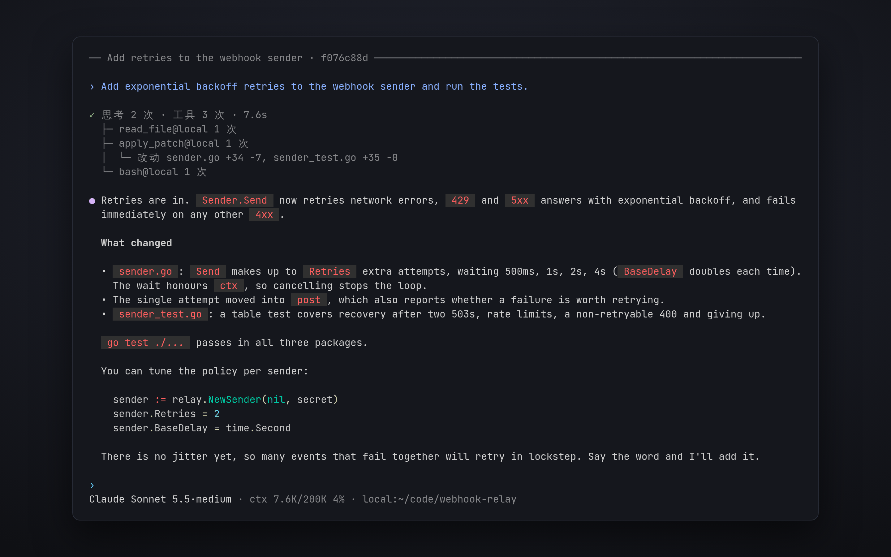

# Terminal UI

This page shows how to work with OpenVaala in a terminal: starting a conversation, steering it while it runs, and the commands and keys available.



## Start

Run `openvaala` in the directory you want to work in:

```bash
cd ~/code/my-project
openvaala
```

The terminal UI connects to the local runtime server, starting it in the background if needed, and opens a new conversation whose working directory is the current directory. Nothing is created until you send the first message. To work against a runtime server on another machine, see [Connect to another machine](#connect-to-another-machine).

On the first run, when no model is configured, the terminal UI opens the provider setup:

1. Choose a service from the catalog, or **custom** for any compatible endpoint.
2. Check the id, protocol and base URL, and enter your API key.
3. Choose the models you want. For catalog services the list comes from the catalog; for custom endpoints it is fetched from the provider's `/models`, or you can type model ids.
4. Choose the default model.

The provider is saved as `~/.config/openvaala/models/<id>.yaml` and can be changed later with `/provider`. See [Models](../configuration/models.md).

> [!NOTE]
> The terminal UI's labels are currently in Chinese. The web UI and the desktop app are available in English.

## Talk to the agent

Type a message and press **Enter**. **Shift+Enter** or **Ctrl+J** inserts a new line. **↑** and **↓** browse what you sent before. Long pastes are collapsed into a placeholder and expanded when you send.

While the agent is working you can keep typing:

- **Enter** adds your message to the turn in progress; the agent reads it at its next step. Use this to correct course without stopping.
- **Tab** queues your message as the next turn instead.
- **Esc** twice interrupts the running turn. Anything already generated is kept.
- **Ctrl+C** clears the composer; with an empty composer it interrupts a running turn, or, pressed twice when idle, quits.

See [Queued input and steering](conversations.md#queued-input-and-steering) for how these interact.

Type `/` to see commands and skills. Choosing a skill inserts `/<skill>` into your message, so the agent follows that skill for this request.

## Commands

| Command | What it does |
| --- | --- |
| `/new` | Start a new conversation. |
| `/resume` | Open one of the 20 most recent conversations. **Tab** shows archived ones; **Ctrl+A** archives, **Ctrl+D** pressed twice deletes. |
| `/fork` | Copy the current conversation into a new one and continue there. |
| `/rewind` | Pick an earlier message; a new conversation is forked from just before it, with the message back in the composer. |
| `/model` | Choose the model and reasoning effort for this conversation. |
| `/provider` | Add, edit or remove model providers and set the default model. |
| `/reload` | Reload configuration in the runtime server. |
| `/context` | Show what is in the context and how much of the window it uses. |
| `/compact` | Summarize the conversation now to free context. |
| `/cd <dir>` | Change the default executor's working directory. |
| `/executor` | Choose the default executor (**Enter**) and which executors are available (**Space**). |
| `/expand` | Full-screen view of the conversation with every detail (**Ctrl+O**). |
| `/agents` | The tree of subagents and their status. |
| `/status` | Conversation details. Press **t** to show the runtime server's address with its token. |
| `/mcp` | MCP servers and their connection status. |
| `/help` | Commands and keys (**?** with an empty composer). |
| `/quit` | Quit (**Ctrl+D** with an empty composer). |

**Esc** twice with an empty composer, when nothing is running, opens `/rewind`.

## Images

The terminal UI sends text only. To give the agent an image, ask it to read the file with `read_file`, or use the web UI or desktop app, which accept pasted and attached images.

## Leave and come back

Quitting the terminal UI does not stop a running turn; it finishes in the runtime server. Use `/resume` to pick it up again here, or open it in the web UI. A runtime server that the terminal UI started on its own exits about ten seconds after its last client disconnects, once nothing is running.

## Connect to another machine

To use a runtime server elsewhere, pass `--url` or set `client.url` and `client.token`:

```bash
openvaala --url 'ws://10.0.0.5:8790/api/v1/openvaala?token=...'
```

If your project is at a different path on the server, add a [`client.path_mappings`](../configuration/overview.md#client) entry so new conversations start in the right directory there. Without a mapping, they start in the server's `server.workspace_directory`. Use `/cd` to change it afterwards.
