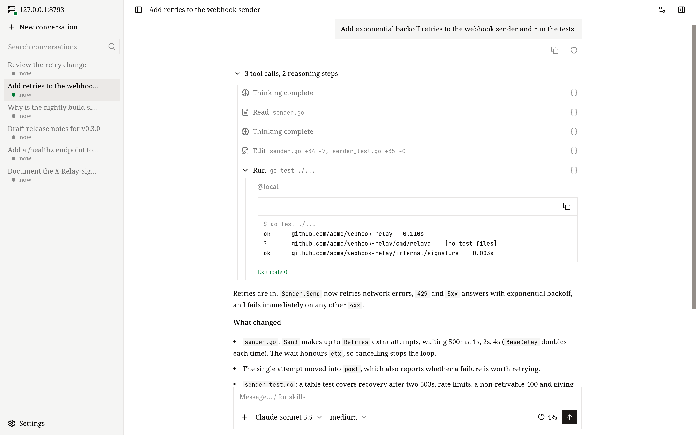
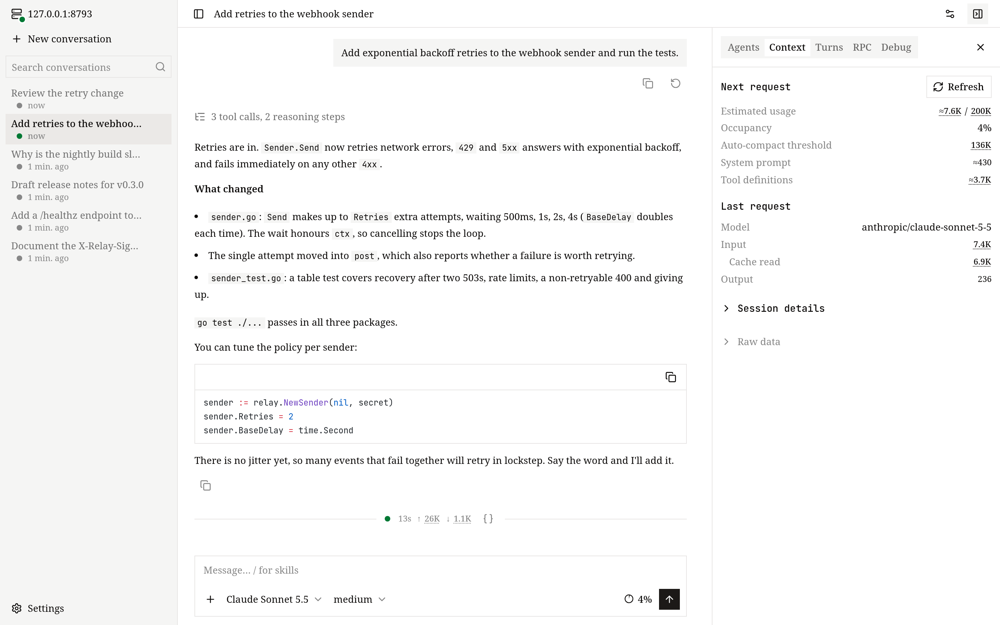
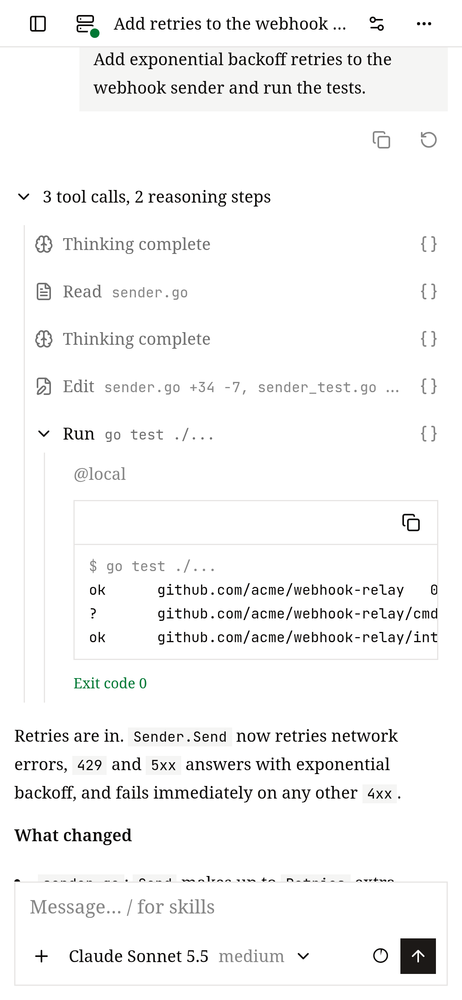

# Web UI

This page shows how to open the web UI, find your way around it, and reach it safely from another machine.

The web UI is served by the runtime server itself, so it shows the same conversations as every other client — including turns that are still running somewhere else.



## Open it

```bash
openvaala web
```

This prints an address like `http://127.0.0.1:8790/web/v1/#token=…` and tries to open it in your browser. If the local runtime server is not running, `openvaala web` starts it and leaves it running until you run `openvaala serve stop`.

The web UI is built into GitHub Release binaries, into `go install` of a published version, and into the desktop app. `go install` of `@main` does not include it, and the page shows *web UI is not built into this binary*; see [Install](../getting-started/install.md).

### The token

The part after `#token=` is the runtime server's access token, and the only credential. The page saves it in your browser's local storage and removes it from the address bar. If it is missing or no longer valid, the page asks for it; run `openvaala web` again to get a fresh address. Anyone with the token can run commands on your executors, so treat it like a password.

## Find your way around

- **Sidebar** — your conversations, newest first, with search. Each conversation's menu offers **Rename**, **Fork**, **Archive** and **Delete**. Archived conversations are under **Settings → Archived conversations**.
- **New conversation** — choose the model and reasoning effort, the executor and the working directory (with suggestions from that executor), then send your first message.
- **Composer** — **Enter** sends, **Shift+Enter** adds a line. Paste, drop or attach images (up to 10 MB in total). Type `/` to pick a [skill](../configuration/extensions.md#skills).
- **Tabs** — the main area is the workspace of the conversation you picked in the sidebar. Its tabs are the main conversation, subagents, side conversations and terminals. See [Tabs, splits and terminals](#tabs-splits-and-terminals).
- **Model picker and context meter** — switch model and effort at any time; the meter shows how full the context is and has a **Compact context** button.
- **Conversation details** — a side panel with tabs:
  - **Agents** — the tree of subagents and their state.
  - **Context** — how full the context is: the estimate for the next request, the automatic compaction threshold, the share taken by the system prompt and tool definitions, and the usage the provider reported for the last request.
  - **Turns** — every turn with its status and token usage.
  - **RPC** — the raw messages between the page and the runtime server, which you can filter, pause and download.
  - **Debug** — the stored data behind any message or tool call.
- **Conversation settings** — the conversation's executors and working directories, its MCP servers and their status, and the skills it can use.
- **Settings** — language (English or Chinese) and appearance; model providers, including fetching a provider's model list; read-only lists of executors, hooks and skills; and **Reload config**.

There is no first-run wizard in the web UI. If no model is configured, add one under **Settings → Model providers**.



## Tabs, splits and terminals

Switch conversations in the sidebar; the main area always shows the tabs of one conversation, and every conversation keeps its own tabs and splits. The tabs are:

- the **main conversation**, which can't be closed,
- **subagents**: clicking a subagent in the Agents panel or in a message opens it in a read-only tab next to the main conversation, which keeps showing the main agent,
- **side conversations** from `/btw`, see below,
- **terminals**.

Each area has a **+** menu at the end of its tab bar to open a terminal there, split the area to the right or below (the new area starts with a new terminal), and maximize it. You can also drag a tab to another area or to an edge of an area to split.

A **terminal** tab opens a shell on the working directory of the conversation it belongs to. The shell runs on the server, so reloading the page or losing the connection does not end it: the tab reconnects to the same shell and catches up on the output it missed (the last 1 MiB is kept). A terminal ends when its shell exits, when you close its tab, when its conversation is deleted, or when the server stops; only then does the tab offer **Restart**.

A running terminal also appears as a tab on other devices that open the same conversation, and you can type in it from either one. After a lot of output, reloading may leave a full-screen program such as vim looking wrong until you reopen it. If the screen gets garbled, choose **Reset terminal** in the **+** menu (or in the tab list on a narrow screen) to clear the kept output and redraw.

When you switch away from a conversation that still has a side conversation or a running terminal, it stays in the background: the side conversation is not dropped and the terminal keeps running. Other conversations stop receiving updates while you are away, and reconnect with the same tabs and splits when you come back. The tabs and splits of the 50 most recently used conversations are kept in the browser. After a reload, the conversation in the address bar gets its layout back right away and the others when you open them. The page for a new conversation has no tabs; it becomes a normal conversation after you send the first message.

### Ask on the side with /btw

While a conversation is running — or after it has finished — type `/btw` followed by a question, for example `/btw why does this use SQLite`. The web UI opens a side conversation in a new tab to the right, which starts from everything the conversation has saved so far. It can read files and run commands, and you can keep asking in it. Nothing from the side conversation is written back to the original conversation, and the original keeps running. The side tab shows only what happens after the fork, with a link back to the original conversation at the top.

A side conversation is temporary. It is not in the conversation list and is not saved; closing its tab interrupts it if it is still running and discards it. After a reload it is kept if it is still alive, otherwise its tab is removed. `/btw` is offered once a conversation has its first message, and not inside a side conversation.

## While the agent is working

Pressing **Enter** while a turn is running adds your message to that turn. **Queue** sends it as the next turn instead, and **Stop** interrupts. Messages waiting to be read appear above the composer, where you can:

- **Retrieve to edit** — take it back into the composer,
- **Add to this turn** — hand a queued message to the running turn,
- **Jump the queue** — stop the running turn and handle this message first,
- **Withdraw** — discard it.

To try again from an earlier point, use **Restart from here** on one of your messages: it forks the conversation just before that message and puts the message back in the composer. See [Conversations](conversations.md) for the details.

## On your phone

The web UI is laid out for small screens too, so you can check on a long task, answer a question or steer the agent from your phone while the work keeps running on your machines.

- The conversation list, the conversation details and the model picker open as drawers, and the composer's controls fit a narrow screen.
- Only one tab is shown at a time. The button with the tab count in the top bar opens a drawer from the bottom to switch between the tabs of the current conversation, close them, or open a terminal. A subagent or a side conversation from `/btw` opens as a new tab and is selected right away.
- On a touch keyboard, Enter adds a new line; send with the **Send** button. Queue and Stop work as on a computer.
- Attach images with the **+** button.



Your phone needs to reach the runtime server: on your home or office network, follow [Access from another machine](#access-from-another-machine); from anywhere else, use an [HTTPS reverse proxy](#over-the-internet-https-reverse-proxy). Then open the address with the token on the phone once — the page remembers the token.

## Access from another machine

By default the runtime server only listens on `127.0.0.1`. To use the web UI from another computer on a network you trust:

1. On the server, set the listen address in `~/.config/openvaala/config.yaml`:

   ```yaml
   server:
     listen: 0.0.0.0:8790
   ```

2. Restart the runtime server so it picks up the change, and keep it running:

   ```bash
   openvaala serve stop
   openvaala serve
   ```

3. In another terminal on the server, run `openvaala web`. Besides the local address it prints a `Network:` address for each of the server's IPv4 addresses. Open one of those in a browser on the other machine.

This is plain HTTP: the token and everything you do travel unencrypted. Only do this on a network you trust.

### Over the internet: HTTPS reverse proxy

Keep `server.listen` on `127.0.0.1:8790` and put an HTTPS reverse proxy in front of it. The proxy must pass WebSocket upgrades for paths under `/api/`. Everything else, including the page under `/web/v1/`, is plain HTTP.

With Caddy, WebSockets work without extra settings:

```text
openvaala.example.com {
    reverse_proxy 127.0.0.1:8790
}
```

With nginx:

```nginx
server {
    listen 443 ssl;
    server_name openvaala.example.com;
    # ssl_certificate and ssl_certificate_key ...

    location / {
        proxy_pass http://127.0.0.1:8790;
    }

    location /api/ {
        proxy_pass http://127.0.0.1:8790;
        proxy_http_version 1.1;
        proxy_set_header Upgrade $http_upgrade;
        proxy_set_header Connection "upgrade";
        proxy_read_timeout 1h;
    }
}
```

Then open `https://openvaala.example.com/web/v1/#token=<token>`. The page connects back over `wss://` automatically. `openvaala web` prints the local address with the token; you can also set a fixed `server.token` in the configuration.

Other clients can use the same proxy: set `client.url: wss://openvaala.example.com/api/v1/openvaala` and `client.token` on your laptop to run the terminal UI, an editor or Codex against that server. See [Configuration → client](../configuration/overview.md#client).

A page always talks to the runtime server it was loaded from. To use several servers, open each one's address in its own tab.
