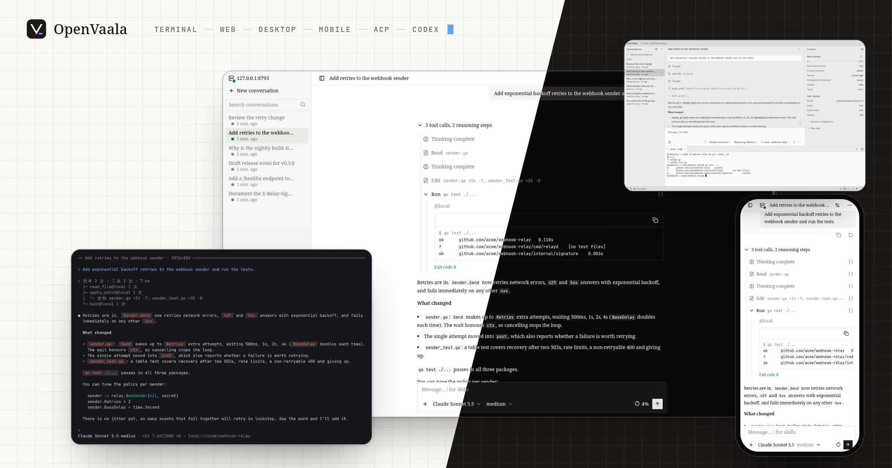

# OpenVaala

OpenVaala is a self-hostable, general-purpose agent system that keeps the agent loop, tool execution and the interfaces you use apart, so that work started on one screen can run on another machine and be picked up anywhere.



In one line: a centralized agent loop with distributed tool execution. Everything can run on a single laptop, or you can put the interfaces, the runtime server and the executors on different machines. Where you type no longer decides where the work happens.

## How it fits together

<!-- scene: unified-runtime | Clients, the runtime server and executors -->
```text
 terminal   web   desktop   editor   Codex
     │       │       │        │        │
     └───────┴───────┼────────┴────────┘
                     │  same conversations, live
            ┌────────▼────────┐
            │ runtime server  │── model providers
            │ agent loop,     │
            │ history         │
            └────────┬────────┘
                     │  tool calls
       ┌─────────────┼──────────────┐
       ▼             ▼              ▼
     local      ssh: buildbox   openvaala
 (this machine) ssh: gpu, ...   (sandbox)
```

- **Clients** — the terminal UI, the web UI, the desktop app, editors that speak ACP, and Codex. They only display and send; closing one never stops the work.
- **The runtime server** (`openvaala serve`) owns every conversation: it calls the models, keeps the history and context, and decides what runs next.
- **Executors** are where tools run — reading and patching files, running commands, starting MCP servers.

## One runtime, many machines

The runtime server manages each task's progress and context; file operations, commands and tools run in the execution environment you select. Alongside this machine and a built-in in-memory sandbox, you can add as many SSH machines as you need — a build box, a GPU machine, a staging server. A conversation can use several of them at once: the agent picks the executor for each tool call, so one task can read code locally, run tests on the build box and check logs on staging. Remote machines need no OpenVaala software, only the standard tools most Linux servers already have. Executors are a layer of their own; support for workers on other machines and hosted sandboxes is planned.

[Executors →](configuration/executors.md)

## Many clients, one live conversation

The terminal UI, the web UI, the desktop app, editors over ACP such as Zed, and Codex clients — the Codex terminal UI, the Codex desktop app on macOS, or anything that speaks the Codex app-server protocol — all attach to the same runtime and the same conversations. Start a task from the terminal, check on it from your phone — the web UI is built for small screens too — and continue it in your editor. What is shared is not just the chat log but the work in progress: text as it streams, queued messages, running tool calls and their output, and the state of every subagent. From the terminal, web and desktop interfaces you can steer a running turn, queue the next request or interrupt it.

[Conversations →](guides/conversations.md) · [Terminal](guides/terminal.md) · [Web](guides/web.md) · [Desktop](guides/desktop.md)

## Works with what you have

OpenVaala connects to models over OpenAI Chat Completions, OpenAI Responses and Claude Messages, so hosted providers, gateways and local model servers all work. Editors such as Zed connect through the Agent Client Protocol, and the Codex terminal UI and desktop app can use OpenVaala as their backend through the Codex app-server protocol. Tools come in through MCP. Change one piece — a model, an interface, a tool — without rebuilding the rest.

[Models](configuration/models.md) · [Editors](guides/editors.md) · [Codex](guides/codex.md) · [MCP servers](configuration/extensions.md#mcp-servers)

## Conversations you can take with you

Each conversation is saved in its own directory as JSON Lines records, and a SQLite database serves only as an index that can be rebuilt from them. You can read the files, back up a single conversation, or move it to another machine; a damaged index does not mean lost history. Storage sits behind two small interfaces by design, so other backends can be added later.

<!-- scene: portable-conversations | One directory per conversation, an index you can rebuild -->
```text
~/.local/share/openvaala/
├── metadata.db           index, rebuilt by
│                         `openvaala reindex`
└── conversations/
    └── <conversation-id>/
        ├── metadata.jsonl     the records:
        └── <session-id>.jsonl source of truth

copy <conversation-id>/ to another machine,
run `openvaala reindex`, and continue there
```

[Where conversations are stored →](guides/conversations.md#where-conversations-are-stored)

<!-- site-home-body -->

## Also included

Subagents that work in parallel and report back, automatic context compaction, skills and `AGENTS.md` project instructions, hooks that can block or rewrite tool calls, plugins installed from git, and OpenTelemetry traces. The documentation you are reading ships inside OpenVaala as a built-in skill, so you can ask an agent how to configure it.

## Where to next

- [Quickstart](getting-started/quickstart.md) — install, add a model and start a conversation.
- [Install](getting-started/install.md) — release binaries, `go install`, or building from source.
- [Guides](guides/conversations.md) — the terminal, web and desktop interfaces, editors and Codex.
- [Configuration](configuration/overview.md) — models, agents, executors, tools and extensions.
- [Reference](reference/cli.md) — every command, and how OpenVaala is [built](reference/architecture.md).
