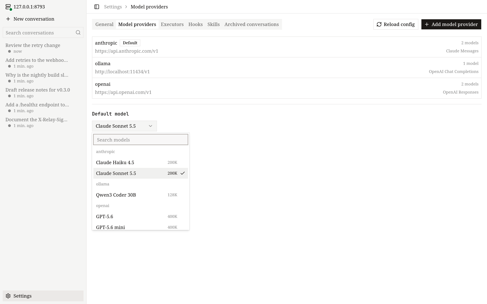

# 模型

这一页介绍怎么把 OpenVaala 连到模型 Provider，以及怎么描述你要用的模型。

一个 *Provider* 就是 `~/.config/openvaala/models/` 里的一个文件，写着地址、API key 和一组模型。Agent 用 `provider_id/model_id` 引用模型，例如 `openai/gpt-5`。

## 不改文件添加 Provider

最快的方式是用任意客户端里的模型服务设置：

- **终端界面：** 还没有配置模型时，第一次运行会带你完成；之后用 `/provider`。
- **Web 界面和桌面端：** **设置 → 模型服务**。

你从基于 [models.dev](https://models.dev) 的目录里选一个服务，它会填好协议、base URL 和已知的模型上限；然后填 API key、选模型。客户端也可以直接从 Provider 拉取模型列表。结果就是一个普通的 Provider 文件，之后可以随意修改。



## 完整的 Provider 文件

```yaml
# ~/.config/openvaala/models/openai.yaml
id: openai                         # 必须和文件名一致
protocol: openai_responses         # 这个文件里模型的默认协议
base_url: https://api.openai.com/v1
api_key: sk-...
models:
  gpt-5:                           # OpenVaala 里的模型 id；upstream_model 默认就是它
    display_name: GPT-5
    context_window: 400000
    max_output_tokens: 128000
    reasoning_efforts: [minimal, low, medium, high]
    default_reasoning_effort: medium
    capabilities:
      input: [text, image]
  mini:
    upstream_model: gpt-5-mini     # 发给 Provider 的模型名
    description: 响应快、成本低，适合检索、信息提取和简单修改。
```

支持多种协议的 Provider 可以混着用。下面这个网关同时提供 OpenAI 风格的模型和 Claude 模型，Claude 的接口在另一个主机上：

```yaml
# ~/.config/openvaala/models/gateway.yaml
id: gateway
protocol: openai_chat
base_url: https://gateway.example.com/v1
api_key: ...
endpoints:
  claude: https://claude.example.com/anthropic/v1/messages
models:
  qwen3-coder: {}
  claude-sonnet:
    upstream_model: claude-sonnet-4-5
    protocol: claude
    capabilities:
      input: [text, image]
```

## 协议

OpenVaala 和模型 Provider 之间支持三种协议，此外还支持客户端和工具两侧的协议：

```text
 models             clients          tools
 openai_responses   terminal, web,   built-in tools
 openai_chat        desktop          MCP servers
 claude             ACP editors      (stdio, http, sse)
                    Codex
     │                  │                │
     └──────────────────┼────────────────┘
                        ▼
                 Runtime 服务
```

在 `protocol` 和 `endpoints` 的键里，要原样使用下面这些名字：

| 名字 | API | 接在 `base_url` 后面的路径 |
| --- | --- | --- |
| `openai_responses`（默认） | OpenAI Responses | `/responses` |
| `openai_chat` | OpenAI Chat Completions | `/chat/completions` |
| `claude` | Anthropic Claude Messages | `/messages` |

`protocol` 也接受 `openai-responses`，会统一成 `openai_responses`；`endpoints` 的键必须用上面的原名。

## Provider 字段

- `id`：必填。可以用字母、数字、`-`、`_` 和 `.`，和去掉 `.yaml` 的文件名一致。
- `protocol`：没写自己协议的模型用这个协议。默认是 `openai_responses`。
- `base_url`：必填。`http` 或 `https` 地址，包含版本前缀，例如 `https://api.openai.com/v1`。不能带用户名、查询参数或 `#` 片段。OpenVaala 会在后面接上上表里的协议路径。
- `endpoints`：可选，按协议写完整的请求地址，写了的协议就不再用 `base_url` 拼。可以指向另一个主机。每个值都必须是带实际路径的 `http(s)` 地址（不能只写主机或 `/`），其他限制和 `base_url` 相同。
- `api_key`：发给 Provider 的 key，以明文保存。不需要 key 的本地服务留空即可。
- `headers`：可选，只发给这个 Provider 的请求头，随它的模型请求和模型列表请求一起发出。`config.yaml` 的 `http.headers` 里有同名条目时，以这里的为准，写成 `""` 就不再发。值里可以用[`http`](overview.md#http)一节介绍的 `${OPENVAALA_...}` 变量。
- `models`：必填，至少一项。键是模型 id（字母、数字、`-`、`_`、`.`）。不需要任何设置的模型可以写成 `name: {}`。

例如，给某个网关多加一个请求头，并且不给它发 `Session-Id`：

```yaml
# ~/.config/openvaala/models/openrouter.yaml（节选）
headers:
  X-Title: MyTool
  Session-Id: ""
```

## 模型字段

每个字段都可以不写。没写的字段取 `config.yaml` 里 `models.defaults` 的值，另有说明的除外。

- `upstream_model`：发给 Provider 的模型名。默认是模型 id。
- `protocol`：只为这个模型覆盖 Provider 的协议。
- `display_name`：模型选择里显示的名字。默认是模型 id。
- `description`：给 Agent 选子 Agent 模型时看的用途说明，会附在 `spawn_agent` 的模型清单里。可以写擅长的任务、速度和成本取舍；不写时不显示说明，也不从 `models.defaults` 继承。不改变现有的模型继承和默认选择规则。
- `context_window`：模型的上下文窗口，单位 token。自动压缩以它为准，请填真实的值。
- `max_output_tokens`：每次请求都会带上的输出上限。如果模型的上限比默认的 32000 小，在这里设置。
- `thinking`：是否要求模型先思考或推理再回答。默认 `true`。
- `reasoning_efforts`：可选的推理强度，原样发给 Provider，例如 `[low, medium, high]`。写 `[]` 表示这个模型没有强度可选；不写则继承默认值。
- `default_reasoning_effort`：你没选强度时用的强度，必须是 `reasoning_efforts` 里的一项。不写时，如果 `models.defaults.default_reasoning_effort` 在列表里就用它，否则用列表第一项。
- `merge_message_roles`：发送前把连续的同角色消息合并成一条的角色，用于不接受同一角色连发两条消息的 Provider。可选值是 `system`、`developer`、`user` 和 `assistant`。`[]` 表示不合并。
- `reasoning_context`：`all_turns` 或 `current_turn`。只能用于 `openai_responses` 协议，也从不继承 `models.defaults`。它以 `reasoning.context` 发送，告诉 Provider 模型能看到多少之前的推理：`all_turns` 保留之前各轮的推理，输入 token 更多；`current_turn` 只保留当前这一轮的推理。不写时不发送，由 Provider 决定。只有 Provider 支持这个参数时才设置。
- `capabilities.input`：模型能接收的输入类型，可以是 `text`、`image`、`audio`、`video`、`pdf` 中的任意几种。空列表表示 `[text]`。没有 `image` 时，对话里的图片（包括 `read_file` 返回的图片）在发送前会换成一段简短的占位文字。

## 继承的默认值

`config.yaml` 里的 `models.defaults` 为模型没写的字段提供值。内置默认值是：

```yaml
models:
  defaults:
    context_window: 256000
    max_output_tokens: 32000
    thinking: true
    reasoning_efforts: []
    default_reasoning_effort: ""
    merge_message_roles: []
    capabilities:
      input: []        # 表示 [text]
```

只覆盖对大多数模型都适用的设置。比如几乎所有模型都能接收图片时：

```yaml
models:
  defaults:
    capabilities:
      input: [text, image]
```

对 `reasoning_efforts`、`merge_message_roles` 和 `capabilities.input`，模型里不写这个字段表示继承默认值，写 `[]` 表示这个模型的值为空。

## 选择模型

- Agent 用 `model: {provider: openai, model: gpt-5}` 指定模型，见 [Agent](agents.md)。
- 没指定模型的 Agent 用 `models.default_model`，或者按 Provider id 和模型 id 排序后的第一个模型。
- 在对话里随时可以切换模型和推理强度：终端界面用 `/model`，Web 界面和桌面端用模型选择，编辑器和 Codex 里用模型选项。从下一轮开始生效。

改完 Provider 文件后，运行 `openvaala config check`，再运行 `openvaala serve reload`；见[让改动生效](overview.md#让改动生效)。
