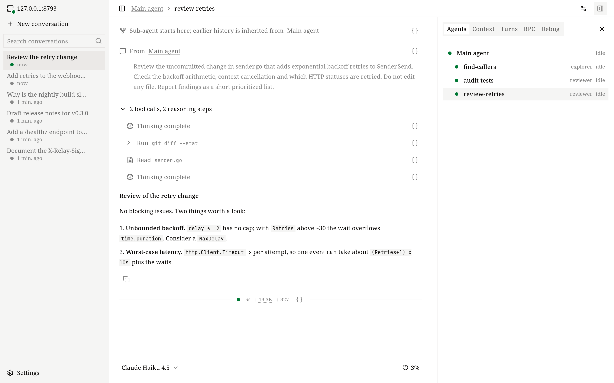

# 对话

这一页介绍对话是怎么运作的：子 Agent、Agent 工作时发送消息、分叉和回退、上下文怎么管理，以及对话怎么存储和迁移。

对话存在 Runtime 服务里，而不是你发起它的那个客户端里。你可以在终端里开始、在浏览器里看、在编辑器里接着做；每个客户端看到的都是同样的消息、同一个正在运行的 Turn、同样实时的工具输出。

## Turn

你每发一条消息，就开始一个 *Turn*：Agent 调用模型，运行模型要求的工具，把结果交回模型，如此反复，直到得出答案。一个 Turn 结束时的状态是完成、失败或中断。一个对话同一时间只运行一个 Turn；这期间你发的消息按下面说的方式处理。

模型调用遇到临时错误（比如流中途断开）时，最多重试 10 次，每次间隔从 1 秒逐渐增加到 30 秒，都失败了这个 Turn 才失败。

## 排队和补充

不用等一个 Turn 结束才能说话。Agent 工作时你发的消息，有三种处理方式：

- **补充**：消息加入正在运行的这一轮。Agent 在下一次调用模型之前读到它，所以你可以不重来就纠正方向。它不会打断已经在进行的模型调用或工具。如果这一轮在读到它之前就结束了，这条消息会成为下一轮。
- **排队**：消息等着，作为下一轮开始。
- **插队**：中断正在运行的这一轮，接着处理这条消息。

<!-- scene: input-queue | Turn 运行时发的消息：补充进这一轮、排到下一轮，或者插队 -->
```text
补充   第 1 轮   模型 ─ 工具 ─┬─ 模型 ─ … ─ 完成
                             └ 在这里读到你的消息
排队   第 1 轮   模型 ─ 工具 ─ 模型 ─ 完成
       第 2 轮                          你的消息 ─ …
插队   第 1 轮   模型 ─ 工具 ╳ 中断，已有输出保留
       第 2 轮               你的消息 ─ …
```

还在等待的消息仍然可以改：取回修改、撤回、把排队的消息加入当前轮，或者让它插队。你的消息总是先于子 Agent 发来的消息处理。等待中的消息只存在内存里，Runtime 服务停掉就没了。

| 客户端 | 补充 | 排队 | 中断 |
| --- | --- | --- | --- |
| 终端界面 | Enter | Tab | 连按两次 Esc |
| Web 界面 | Enter | **排队** 按钮 | **中断** 按钮 |
| 桌面端（原生界面） | Enter | Ctrl/Cmd+Enter | 输入框为空时按 Esc |
| 编辑器（ACP） | — | — | 取消 |

### 中断

中断时，Agent 已经生成的内容都会保留：写了一半的文字留在对话里，没完成的推理和工具调用标记为已中断。下一轮开始时，模型会被告知上一轮被中断了。你中断根 Agent 之后，子 Agent 发来的消息会先等着，直到你再发消息。

## 子 Agent

Agent 可以用 `spawn_agent` 工具把任务的一部分交给*子 Agent*，比如并行调查代码库的三个部分，或者让一个审查者检查改动。每个子 Agent：

- 有自己的上下文，从任务消息开始；需要的话，还可以带上父 Agent 一部分已完成的历史；
- 可以是任何一个配置好的 [Agent](../configuration/agents.md)，由模型按 `description` 来选，用父 Agent 的模型或它自己的模型；
- 和对话共用同一批 Executor 和工作目录；
- 每完成一轮就自动向父 Agent 汇报；
- 自己也可以再启动子 Agent。

<!-- scene: subagents | 子 Agent 并行运行，每跑完一轮就向父 Agent 汇报 -->
```text
                     父 Agent
          spawn_agent ×3 │   ▲ 每跑完一轮就汇报
       ┌─────────────────┼───┴─────────────┐
       ▼                 ▼                 ▼
   子 Agent          子 Agent          子 Agent
   各自的上下文      各自的上下文      各自的上下文
       └──── 共用对话的 Executor 和工作目录 ────┘
```

父 Agent 可以用[协作工具](../configuration/tools.md#协作工具)给子 Agent 发消息、等待、中断和查看它们。你可以在终端界面的 `/agents` 和 Web 界面的 **Agent** 标签页里跟踪它们；在 Codex 里，每个子 Agent 是一个单独的 thread。



## 分叉、回退、归档和删除

- **分叉**把一个对话复制成新对话，你可以换个方向试，原对话保持不变。只复制根 Agent 的历史，不复制子 Agent、排队的消息和归档状态。终端界面的 `/fork` 会复制到最近一轮为止的全部内容。如果 Agent 还在处理某一轮，这一轮已经保存的部分也会复制过去，在新对话里显示为已中断。
- **回退**是一种分叉：复制到你之前某条消息之前为止，并把这条消息放回输入框，让你改一改再发。在终端界面用 `/rewind`（或者在输入框为空时连按两次 Esc），在 Web 界面用 **从这里重来**。原对话保持不变。

<!-- scene: conversation-fork | 分叉复制整段历史；回退只复制到你的某条消息之前 -->
```text
fork
  original  ●──●──●──●          不变
  new       ●──●──●──● ──▶      在这里继续

rewind to your message ③
  original  ●──●──③──●──●       不变
  new       ●──●  ③ 放回输入框，
                  改一改再发
```

- **归档**把对话从主列表里藏起来，不改动它；取消归档就回来了。归档不会停下正在运行的 Turn。
- **删除**会彻底删掉对话和它的目录。有 Turn 正在运行时不能删除。
- **改名**修改标题。新对话会自动用你第一条消息的第一行做标题（最多 40 个字符），直到你改名。

新对话在你发出第一条消息时才保存；打开后什么都没发的对话不会留下。

## 上下文和压缩

每个模型的上下文窗口都有限。OpenVaala 会跟踪一个对话用了多少，在溢出之前把较早的历史总结掉。

**用量。** 你看到的数字（Web 界面的上下文占用、终端界面的 `/context`、编辑器里的用量报告）以 Provider 为上一次请求报告的 token 数为基础，再加上之后新增内容的估算。没有最近的报告时，就是对全部内容的估算；Web 界面会告诉你看到的是哪一种。

**自动压缩。** 每次调用模型之前，如果下一次请求会达到阈值，Agent 会先压缩。阈值是模型 `context_window` 的 80%；如果 `context_window − max_output_tokens` 更小，就用后者，这样总能留出一次完整回答的空间。所以[模型配置](../configuration/models.md#模型字段)里的 `context_window` 和 `max_output_tokens` 要和真实模型一致。

**压缩做了什么。** 调用一次压缩模型，为较早的历史（包括之前的摘要）写一份累积摘要。之后模型看到的是这份摘要，加上对话最近的一部分：至少占窗口的 20%，按完整的步骤截取。

<!-- scene: context-compaction | 上下文到达阈值时，较早的历史折叠成摘要 -->
```text
窗口       ├──────────────────────────────────┤
阈值       ├────────────────────────────┤
           min(窗口的 80%,
               窗口 − max_output_tokens)

压缩前  │sys│ 1 │ 2 │ 3 │ 4 │ 5 │ 6 │ 7 │  到达阈值
压缩后  │sys│ 1–5 的摘要     │ 6 │ 7 │      保留最近的部分

1–7 全部留在磁盘上，客户端里也都看得到
```
完整的历史留在磁盘上，客户端里也都能看到，变小的只是发给模型的内容。压缩之后会重新加入 `AGENTS.md` 说明。压缩失败时，这个 Turn 也失败。

**手动压缩。** 在终端界面用 `/compact`，在 Web 界面点 **压缩上下文**，或者在 Codex 里执行压缩，都会立即总结根 Agent 的历史。只有在没有任务运行、也没有消息等待时才能用。

**压缩模型。** 摘要由 Agent 的 [`compact_model`](../configuration/agents.md#字段) 来写，默认就是 Agent 自己的模型。它的上下文窗口不能比主模型小。

**推理上下文。** 对 `openai_responses` 协议的模型，[`reasoning_context`](../configuration/models.md#模型字段) 会告诉 Provider，是把之前各轮的推理留在上下文里（`all_turns`），还是只留当前这一轮的（`current_turn`）。OpenVaala 会读取 Provider 实际用了哪种方式，并据此计算用量。

## 对话存在哪里

对话保存在运行 Runtime 服务的那台机器上，位于 `~/.local/share/openvaala/`：

```text
~/.local/share/openvaala/
├── metadata.db                 对话、Session 和 Turn 的索引（SQLite）
├── runtime.lock                正在运行的 OpenVaala 进程持有的锁
└── conversations/
    └── <conversation-id>/
        ├── metadata.jsonl      对话、它的 Session 和 Turn，只追加写入的日志
        └── <session-id>.jsonl  一个 Agent 历史里的每个 Item：消息、工具调用、图片、摘要
```

每个对话都是一个自成一体的目录，里面是 JSON Lines 文件。每次改动都先追加写入并刷到磁盘，再更新索引。`metadata.db` 只用来加快列表和搜索，随时可以从这些目录重建：

```bash
openvaala serve stop
openvaala reindex
```

`reindex` 会重放每个 `metadata.jsonl`，报告需要跳过的对话，并把中途被打断的删除做完。它需要独占数据目录，所以要先停掉 Runtime 服务。

要备份一个对话，在 Runtime 服务停止时拷贝它的目录。

## 把对话迁移到另一台机器

1. 在旧机器上运行 `openvaala serve stop`，然后拷出 `~/.local/share/openvaala/conversations/<conversation-id>/`。
2. 在新机器上放到同一个位置；已有同 ID 的目录就整个替换。
3. 如果新机器上有 Runtime 服务在运行，先运行 `openvaala serve stop`，再运行 `openvaala reindex`。
4. 在终端界面的 `/resume` 或 Web 界面的侧边栏里打开这个对话。

迁移之后要检查：

- 对话用绝对路径记住了它的工作目录。如果新机器上没有这个目录，对话就打不开；重新建好这个目录，或者保持相同的目录结构。
- 它用过的 Agent 在新机器的配置里必须存在。如果缺了某个模型，发消息前先换一个模型。
- 压缩之后分叉出来的对话，有一部分较早的历史要从它分叉的源对话里读。这两个对话要一起迁移。
