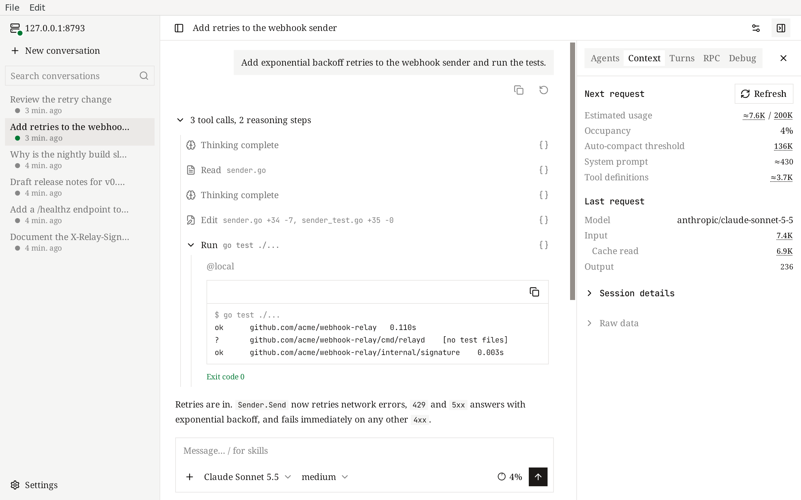
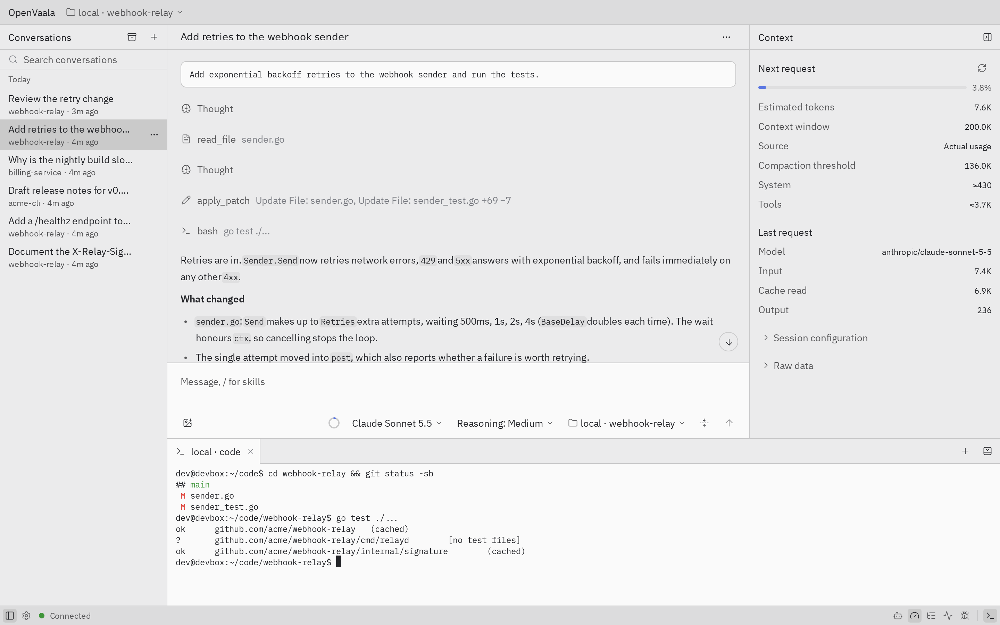

# 桌面端

这一页介绍 macOS 和 Linux 上的 OpenVaala 桌面端：两种界面、它和 Runtime 服务的关系，以及各平台的注意事项。

桌面端是一个程序，里面有两种界面，外加完整的命令行工具：

- **WebView**（默认）：在原生窗口里显示 [Web 界面](web.md)。
- **原生界面**：OpenVaala 自己绘制的界面，多了一些功能，比如内置终端。



## 打开

从应用菜单里启动 **OpenVaala**，或者在终端里运行：

```bash
openvaala                 # WebView 窗口
openvaala app --native    # 原生界面
```

这里的 `openvaala` 指桌面端自己的可执行文件（见[从桌面端使用 CLI](#从桌面端使用-cli)）。每种界面最多开一个窗口，再次启动同一种界面会把已有窗口切到前面。WebView 窗口和原生窗口可以同时开着。

还没有配置模型 Provider 时，在 **设置 → 模型服务** 里添加。原生界面的空白页上也有一个 **添加模型服务** 按钮。

## 和 Runtime 服务的关系

两种界面都用本机的 Runtime 服务，没在运行就启动它，所以它们和终端界面、浏览器里的 Web 界面、编辑器、Codex 共享所有对话：

<!-- scene: shared-progress | 每个客户端实时显示同一个对话 -->
```text
            Runtime 服务
       ┌─ one conversation ─┐
       │  messages, tools,  │
       │  queue, subagents  │
       └──┬───────┬──────┬──┘
          ▼       ▼      ▼
      terminal  browser  desktop
      （各自实时显示
        同一个 Turn）
```

桌面端启动的 Runtime 服务在你关掉窗口后会继续运行，直到你执行 `openvaala serve stop`。

关掉窗口不会停下你已经发出的任何任务：正在运行的 Turn 会继续，可能继续消耗模型 Provider 的额度。原生界面终端面板里打开的终端会随窗口一起关闭。

桌面端总是连接本机的 Runtime 服务。要用别处的服务器，用带 `--url` 的[终端界面](terminal.md)，或者在浏览器里打开那台服务器的 [Web 界面](web.md)。

## WebView 和原生界面

两种界面都有对话、子 Agent、上下文、Turn、RPC 和调试面板，排队消息，以及模型服务设置。原生界面另外还有：

- 终端面板，
- 命令面板（Ctrl+K，macOS 上是 Cmd+K），
- 把对话导出为 Markdown，
- 一轮结束时的系统通知，
- 粘贴图片、选择图片文件，以及输入框快捷键（Ctrl/Cmd+Enter 排队一条消息；输入框为空时按 Esc 停下正在运行的那一轮；↑ 调出以前发过的消息）。



两种界面之间不共享未发送的草稿和界面偏好。WebView 里的草稿在窗口关闭或刷新时会丢失。原生界面在有未发送草稿或未保存设置时，退出前会先问你。

两种界面都可以在设置里切换中英文、切换浅色和深色主题。原生界面默认是中文，在通用设置的 **语言** 里修改。

## 平台说明

### macOS

- 需要 macOS 12 或更高版本。应用是同时支持 Apple 芯片和 Intel 的通用版。
- WebView 界面用系统自带的 WebKit，不需要额外安装。
- 发布的安装包暂未经过 Apple Developer ID 签名和公证。

### Linux

- 支持 amd64 和 arm64。
- 原生界面需要 GTK 3。WebView 界面还需要 WebKitGTK 4.1（Debian 和 Ubuntu 上是 `libwebkit2gtk-4.1-0`）。没装的话，WebView 打不开，并提示改用 `openvaala app --native`，原生界面照样能用。

不支持 Windows。

## 从桌面端使用 CLI

桌面端包含所有 `openvaala` 命令（`tui`、`serve`、`web`、`acp`、`codex` 等），但它不会把自己加进 `PATH`，也不会替换你另外安装的 `openvaala`。要用它的 CLI，直接运行应用里的可执行文件：

```bash
# macOS
/Applications/OpenVaala.app/Contents/MacOS/OpenVaala tui
```

如果你还另外装了一个不同版本的 `openvaala`，当正在运行的 Runtime 服务是由另一个可执行文件启动的时候，客户端会给出提示。运行 `openvaala serve stop`，再让你想用的那个重新启动它。
