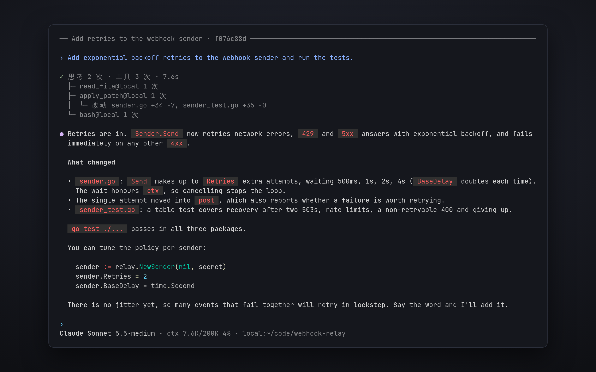

# 终端界面

这一页介绍怎么在终端里用 OpenVaala：开始对话、在它运行时补充消息，以及有哪些命令和按键。



## 启动

在要工作的目录里运行 `openvaala`：

```bash
cd ~/code/my-project
openvaala
```

终端界面会连接本机的 Runtime 服务，没在运行就在后台启动它，然后打开一个新对话，工作目录就是当前目录。发出第一条消息之前，什么都不会创建。要连另一台机器上的 Runtime 服务，见[连接另一台机器上的服务](#连接另一台机器上的服务)。

第一次运行、还没有配置模型时，终端界面会打开「添加模型服务」：

1. 从目录里选一个服务；任何兼容的接口选「自定义」。
2. 核对 ID、协议和 base URL，填 API key。
3. 选要用的模型。目录里的服务从目录取模型列表；自定义接口从 Provider 的 `/models` 拉取，也可以手动输入模型 ID。
4. 选默认模型。

Provider 保存为 `~/.config/openvaala/models/<id>.yaml`，以后可以用 `/provider` 修改。见[模型](../configuration/models.md)。

> [!NOTE]
> 终端界面目前只有中文。Web 界面和桌面端也提供英文。

## 和 Agent 对话

输入消息，按 **Enter** 发送。**Shift+Enter** 或 **Ctrl+J** 换行。**↑** 和 **↓** 翻看以前发过的消息。粘贴的长文本会折叠成一个占位符，发送时再展开。

Agent 工作的时候，你可以接着输入：

- **Enter** 把消息补充进正在进行的这一轮，Agent 在下一步读到它。适合不停下来就纠正方向。
- **Tab** 把消息排队，作为下一轮。
- 连按两次 **Esc** 中断正在运行的这一轮。已经生成的内容都会保留。
- **Ctrl+C** 清空输入框；输入框为空时，它会中断正在运行的这一轮，空闲时连按两次退出。

这几种方式怎么配合，见[排队和补充](conversations.md#排队和补充)。

输入 `/` 可以看到命令和 skill。选中一个 skill 会把 `/<skill>` 插进消息里，Agent 处理这次请求时就会按这个 skill 来做。

## 命令

| 命令 | 作用 |
| --- | --- |
| `/new` | 开始新对话。 |
| `/resume` | 打开最近 20 个对话之一。**Tab** 显示已归档的；**Ctrl+A** 归档，连按两次 **Ctrl+D** 删除。 |
| `/fork` | 把当前对话复制成一个新对话，在新对话里继续。 |
| `/rewind` | 选一条以前的消息，从它之前分叉出一个新对话，这条消息放回输入框。 |
| `/model` | 选这个对话用的模型和推理强度。 |
| `/provider` | 添加、修改、删除模型 Provider，设置默认模型。 |
| `/reload` | 让 Runtime 服务重新加载配置。 |
| `/context` | 查看上下文里有什么、占了窗口多少。 |
| `/compact` | 立即总结对话，腾出上下文。 |
| `/cd <dir>` | 修改默认 Executor 的工作目录。 |
| `/executor` | 选默认 Executor（**Enter**）和哪些 Executor 可用（**Space**）。 |
| `/expand` | 全屏查看对话的所有细节（**Ctrl+O**）。 |
| `/agents` | 子 Agent 的树和各自的状态。 |
| `/status` | 对话信息。按 **t** 显示带 token 的 Runtime 服务地址。 |
| `/mcp` | MCP server 和它们的连接状态。 |
| `/help` | 命令和按键（输入框为空时按 **?**）。 |
| `/quit` | 退出（输入框为空时按 **Ctrl+D**）。 |

输入框为空、也没有任务在运行时，连按两次 **Esc** 会打开 `/rewind`。

## 图片

终端界面只能发送文字。要让 Agent 看图片，可以让它用 `read_file` 读图片文件，或者用 Web 界面、桌面端，它们支持粘贴和附加图片。

## 离开和回来

退出终端界面不会停掉正在运行的那一轮，它会在 Runtime 服务里跑完。之后用 `/resume` 在这里接着看，或者在 Web 界面里打开。终端界面自己拉起的 Runtime 服务，在最后一个客户端断开、也没有任务在运行之后，大约十秒自动退出。

## 连接另一台机器上的服务

要用别处的 Runtime 服务，传 `--url`，或者设置 `client.url` 和 `client.token`：

```bash
openvaala --url 'ws://10.0.0.5:8790/api/v1/openvaala?token=...'
```

如果项目在服务器上的路径不一样，加一条 [`client.path_mappings`](../configuration/overview.md#client)，新对话就会从服务器上对应的目录开始。没有映射时，新对话从服务器的 `server.workspace_directory` 开始，之后可以用 `/cd` 修改。
