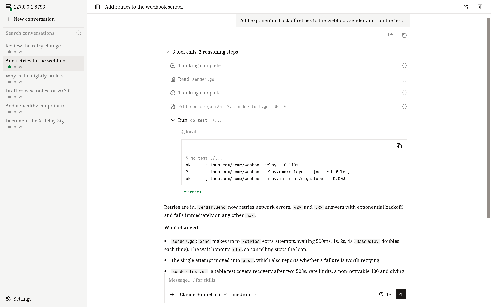
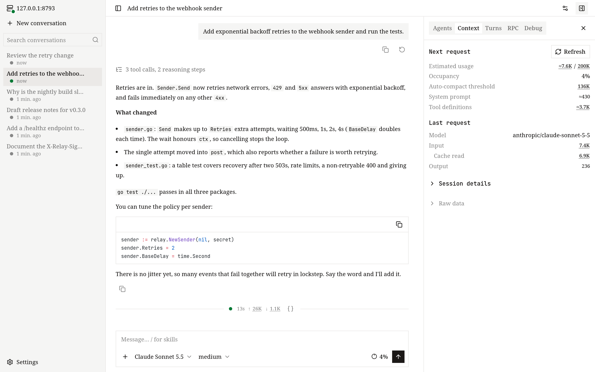
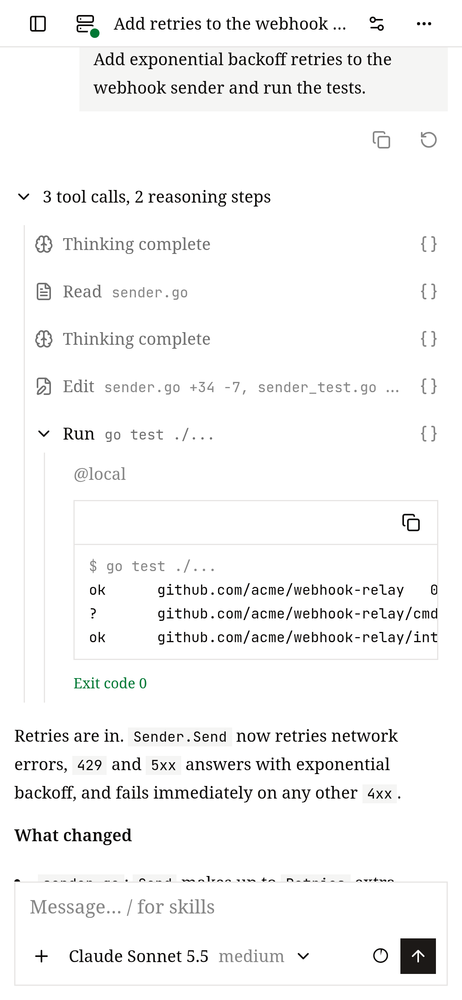

# Web 界面

这一页介绍怎么打开 Web 界面、界面里各部分在哪，以及怎么从另一台机器安全地访问它。

Web 界面由 Runtime 服务自己提供，所以它显示的对话和其他客户端完全一样，包括在别处还在运行的 Turn。



## 打开

```bash
openvaala web
```

它会打印一个类似 `http://127.0.0.1:8790/web/v1/#token=…` 的地址，并尝试用浏览器打开。如果本机的 Runtime 服务没在运行，`openvaala web` 会启动它，并且让它一直运行，直到你执行 `openvaala serve stop`。

GitHub Releases 里的二进制和桌面端都内置了 Web 界面。用 `go install` 构建的二进制没有，页面会显示 *web UI is not built into this binary*，见[安装](../getting-started/install.md)。

### Token

`#token=` 后面那段是 Runtime 服务的访问 token，也是唯一的凭据。页面会把它存进浏览器的本地存储，并从地址栏里去掉。缺少 token 或 token 失效时，页面会让你输入；重新运行 `openvaala web` 就能拿到新地址。拿到 token 的人可以在你的 Executor 上执行命令，请像密码一样保管它。

## 界面导览

- **侧边栏**：你的对话，最新的在最上面，可以搜索。每个对话的菜单里有 **改名**、**分叉**、**归档** 和 **删除**。已归档的对话在 **设置 → 归档对话**。
- **新对话**：选模型和推理强度、Executor 和工作目录（会列出这个 Executor 上的目录候选），然后发出第一条消息。
- **输入框**：**Enter** 发送，**Shift+Enter** 换行。可以粘贴、拖入或附加图片（总共不超过 10 MB）。输入 `/` 选择 [skill](../configuration/extensions.md#skill)。
- **模型选择和上下文占用**：随时切换模型和推理强度；占用指示显示上下文用了多少，旁边有 **压缩上下文** 按钮。
- **对话详情**：侧边面板，分几个标签页：
  - **Agent**：子 Agent 的树和各自的状态。
  - **上下文**：上下文用了多少，包括下一次请求的估算、自动压缩的阈值、系统指令和工具定义各占多少，以及上一次请求 Provider 报告的用量。
  - **Turn**：每个 Turn 的状态和 token 用量。
  - **RPC**：页面和 Runtime 服务之间的原始消息，可以筛选、暂停和下载。
  - **调试**：任意一条消息或工具调用背后存储的数据。
- **对话设置**：这个对话的 Executor 和工作目录、它的 MCP server 和连接状态，以及它能用的 skill。
- **设置**：语言（English 或中文）和外观；模型服务，包括从 Provider 拉取模型列表；Executor、hook 和 skill 的只读列表；以及 **重新加载配置**。

Web 界面没有首次运行的引导。还没有配置模型时，在 **设置 → 模型服务** 里添加。



## Agent 工作时

Turn 正在运行时按 **Enter**，消息会补充进这一轮。点 **排队** 则作为下一轮发送，点 **中断** 停下当前这一轮。还没被读到的消息显示在输入框上方，你可以：

- **取回修改**：把它拿回输入框，
- **加入当前轮**：把排队的消息交给正在运行的这一轮，
- **插队**：停下正在运行的这一轮，先处理这条消息，
- **撤回**：丢掉它。

想从之前某一步重来，在你的某条消息上点 **从这里重来**：它会从这条消息之前分叉出一个对话，并把这条消息放回输入框。细节见[对话](conversations.md)。

## 在手机上用

Web 界面也为小屏幕做了布局，你可以在手机上查看长任务的进度、回答 Agent 的问题、给它补充方向，工作照样在你的机器上继续跑。

- 对话列表、对话详情和模型选择都以抽屉形式打开，输入框的控件也适配窄屏。
- 用触屏键盘时，Enter 是换行，用 **发送** 按钮发送。排队和中断和在电脑上一样。
- 用 **+** 按钮附加图片。



手机要能连到 Runtime 服务：在家里或办公室的网络里，按[从另一台机器访问](#从另一台机器访问)来做；在其他地方，用 [HTTPS 反向代理](#经公网访问用-https-反向代理)。然后在手机上打开一次带 token 的地址，页面会记住 token。

## 从另一台机器访问

默认情况下 Runtime 服务只监听 `127.0.0.1`。要在可信网络里的另一台电脑上用 Web 界面：

1. 在服务器上，修改 `~/.config/openvaala/config.yaml` 里的监听地址：

   ```yaml
   server:
     listen: 0.0.0.0:8790
   ```

2. 重启 Runtime 服务让改动生效，并保持它运行：

   ```bash
   openvaala serve stop
   openvaala serve
   ```

3. 在服务器的另一个终端里运行 `openvaala web`。除了本机地址，它还会为服务器的每个 IPv4 地址打印一行 `Network:` 地址。在另一台机器的浏览器里打开其中一个。

这样走的是明文 HTTP：token 和你的所有操作都不加密传输。只在可信网络里这样用。

### 经公网访问用 HTTPS 反向代理

`server.listen` 保持 `127.0.0.1:8790`，在它前面放一个 HTTPS 反向代理。代理必须为 `/api/` 下的路径转发 WebSocket 升级；其他路径（包括 `/web/v1/` 下的页面）都是普通 HTTP。

用 Caddy 时，WebSocket 不需要额外设置：

```text
openvaala.example.com {
    reverse_proxy 127.0.0.1:8790
}
```

用 nginx 时：

```nginx
server {
    listen 443 ssl;
    server_name openvaala.example.com;
    # ssl_certificate 和 ssl_certificate_key ……

    location / {
        proxy_pass http://127.0.0.1:8790;
    }

    location /api/ {
        proxy_pass http://127.0.0.1:8790;
        proxy_http_version 1.1;
        proxy_set_header Upgrade $http_upgrade;
        proxy_set_header Connection "upgrade";
        proxy_read_timeout 1h;
    }
}
```

然后打开 `https://openvaala.example.com/web/v1/#token=<token>`。页面会自动通过 `wss://` 连回去。`openvaala web` 会打印带 token 的本机地址；也可以在配置里设一个固定的 `server.token`。

其他客户端也能走同一个代理：在笔记本上设置 `client.url: wss://openvaala.example.com/api/v1/openvaala` 和 `client.token`，就能让终端界面、编辑器或 Codex 连这台服务器。见[配置 → client](../configuration/overview.md#client)。

一个页面只和加载它的那个 Runtime 服务通信。要用好几台服务器，就在各自的标签页里打开各自的地址。
