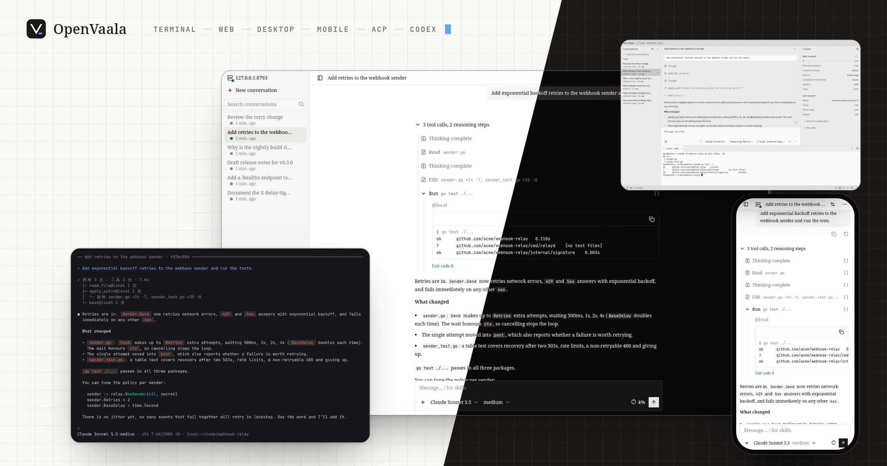

# OpenVaala

OpenVaala 是一个可自托管的通用 Agent 系统。它把 Agent 主循环、工具执行和你用的界面分开：在一块屏幕上发起的工作，可以在另一台机器上执行，在任何地方接着看。



一句话概括：Agent 主循环集中运行，工具分布执行。可以全部跑在一台笔记本上，也可以把界面、Runtime 服务和 Executor 放到不同的机器上。在哪里操作，不再决定任务必须在哪里执行。

## 各部分怎么配合

<!-- scene: unified-runtime | 客户端、Runtime 服务和 Executor -->
```text
 terminal   web   desktop   editor   Codex
     │       │       │        │        │
     └───────┴───────┼────────┴────────┘
                     │  同一份对话，实时同步
            ┌────────▼────────┐
            │ runtime server  │── 模型 Provider
            │ agent loop,     │
            │ history         │
            └────────┬────────┘
                     │  工具调用
       ┌─────────────┼──────────────┐
       ▼             ▼              ▼
     local      ssh: buildbox   openvaala
 (this machine) ssh: gpu, ...   (sandbox)
```

- **客户端**：终端界面、Web 界面、桌面端、支持 ACP 的编辑器和 Codex。它们只负责显示和发送，关掉任何一个都不会让工作停下。
- **Runtime 服务**（`openvaala serve`）拥有所有对话：调用模型、保存历史和上下文、决定下一步做什么。
- **Executor** 是工具运行的地方：读文件、改文件、跑命令、启动 MCP server。

## 统一运行，跨机执行

每个任务的进展和上下文由 Runtime 服务统一管理，文件操作、命令和工具在你选定的执行环境里完成。除了这台机器和一个内置的内存沙箱，你还可以按需添加任意多台 SSH 机器，比如构建机、GPU 机器、预发布服务器。一个对话可以同时用其中好几台：Agent 每次调用工具时自己选 Executor，所以同一个任务可以在本机读代码、在构建机上跑测试、在预发布服务器上查日志。远端机器不用装 OpenVaala，大多数 Linux 服务器自带的工具就够了。Executor 是独立的一层，对其他机器上的 worker 和托管沙箱的支持在计划中。

[Executor →](configuration/executors.md)

## 多种入口，同一份进展

终端界面、Web 界面、桌面端、Zed 这类通过 ACP 接入的编辑器，还有 Codex 客户端（Codex 终端界面、macOS 上的 Codex 桌面版，以及任何支持 Codex app-server 协议的客户端），都连着同一个 Runtime、同一批对话。在终端发起任务，用手机看进度（Web 界面在小屏幕上也好用），再回到编辑器继续。共享的不只是聊天记录，还有正在进行的工作：正在生成的文字、排队的消息、正在跑的工具调用和输出，以及每个子 Agent 的状态。在终端、Web 和桌面端里，都可以给正在运行的 Turn 补充消息、排队下一个请求，或者中断它。

[对话 →](guides/conversations.md) · [终端界面](guides/terminal.md) · [Web 界面](guides/web.md) · [桌面端](guides/desktop.md)

## 接入不同生态，不绑定单一入口

OpenVaala 通过 OpenAI Chat Completions、OpenAI Responses 和 Claude Messages 连接模型，云端服务、网关和本地模型服务都能用。Zed 这类编辑器通过 Agent Client Protocol 接入；Codex 终端界面和桌面版可以通过 Codex app-server 协议把 OpenVaala 当后端。工具通过 MCP 接入。换掉其中一项（模型、界面或工具），不用重搭其他部分。

[模型](configuration/models.md) · [编辑器](guides/editors.md) · [Codex](guides/codex.md) · [MCP server](configuration/extensions.md#mcp-server)

## 对话独立保存，数据可以带走

每个对话存在自己的目录里，记录是 JSON Lines 格式；SQLite 数据库只是索引，随时能从记录重建。你可以直接读这些文件，单独备份一个对话，或者把它搬到另一台机器上；索引坏了也不等于工作历史丢了。存储层在设计上只依赖两个小接口，以后可以接入别的后端。

<!-- scene: portable-conversations | 每个对话一个目录，索引可以重建 -->
```text
~/.local/share/openvaala/
├── metadata.db           索引，用
│                         `openvaala reindex` 重建
└── conversations/
    └── <conversation-id>/
        ├── metadata.jsonl     这些记录是
        └── <session-id>.jsonl 唯一的事实来源

把 <conversation-id>/ 拷到另一台机器，
运行 `openvaala reindex`，接着用
```

[对话存在哪里 →](guides/conversations.md#对话存在哪里)

<!-- site-home-body -->

## 其他能力

并行工作并自动汇报结果的子 Agent、自动压缩上下文、skill 和 `AGENTS.md` 项目说明、能拦下或改写工具调用的 hook、从 git 安装的插件，以及 OpenTelemetry trace。你正在读的这份文档也作为内置 skill 打包在 OpenVaala 里，可以直接问 Agent 怎么配置。

## 接下来

- [快速开始](getting-started/quickstart.md)：安装、添加模型、开始第一个对话。
- [安装](getting-started/install.md)：Release 二进制、`go install`，或者从源码构建。
- [使用指南](guides/conversations.md)：终端、Web 和桌面端界面，编辑器和 Codex。
- [配置](configuration/overview.md)：模型、Agent、Executor、工具和扩展。
- [参考](reference/cli.md)：所有命令，以及 OpenVaala 是[怎么搭起来的](reference/architecture.md)。
